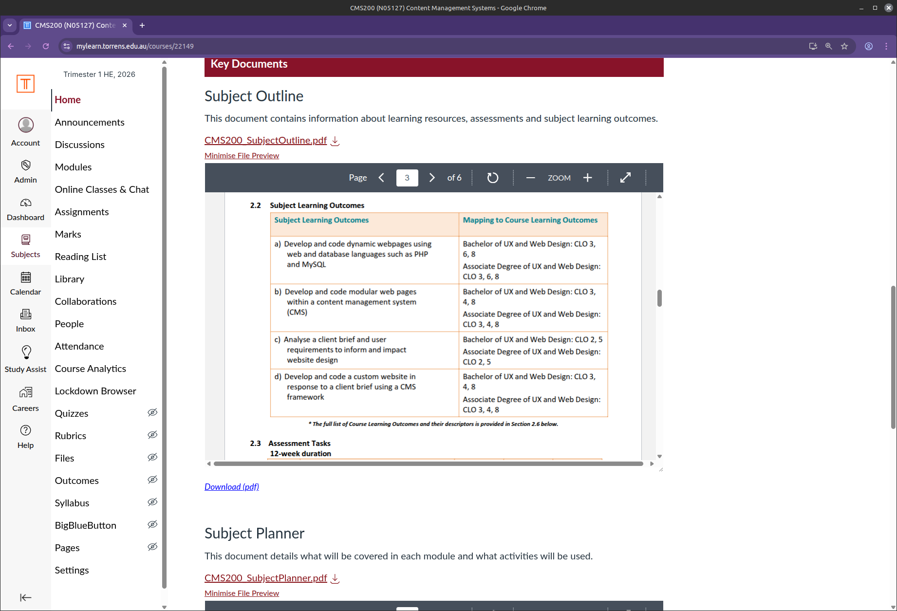
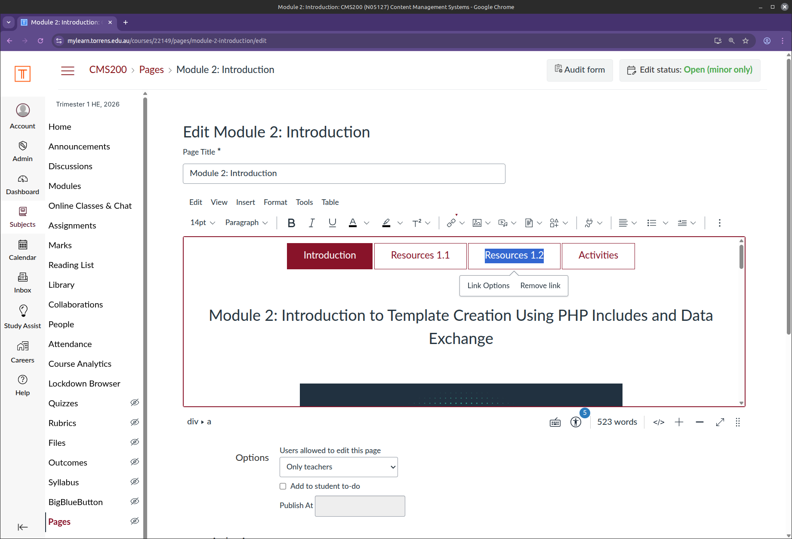
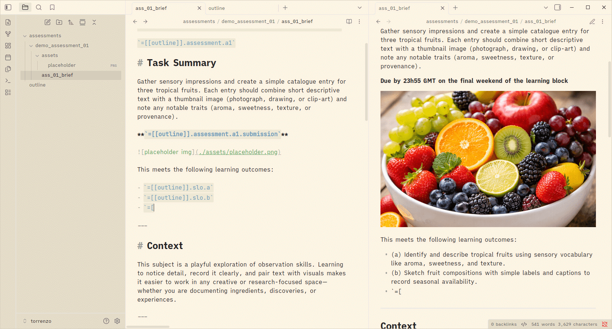
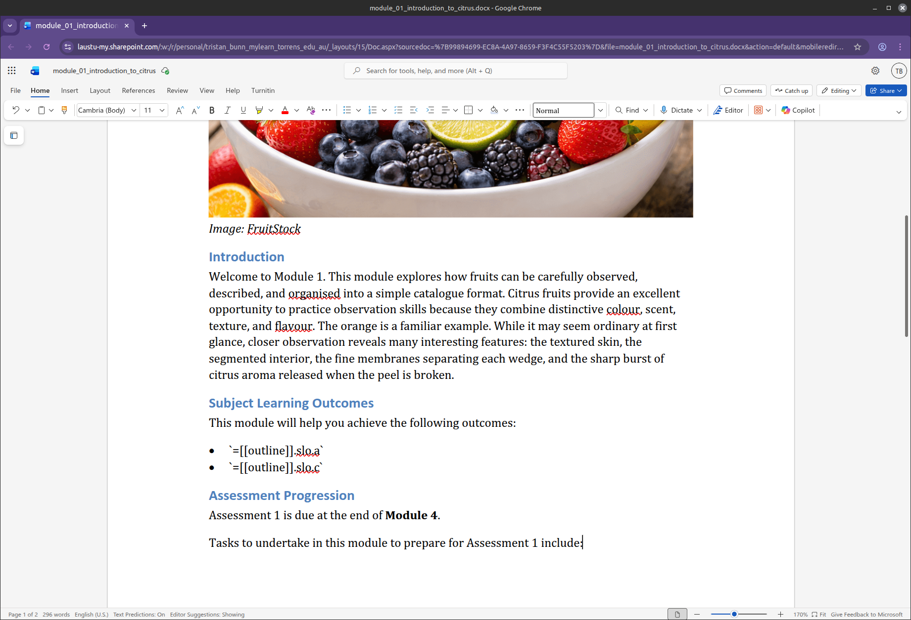
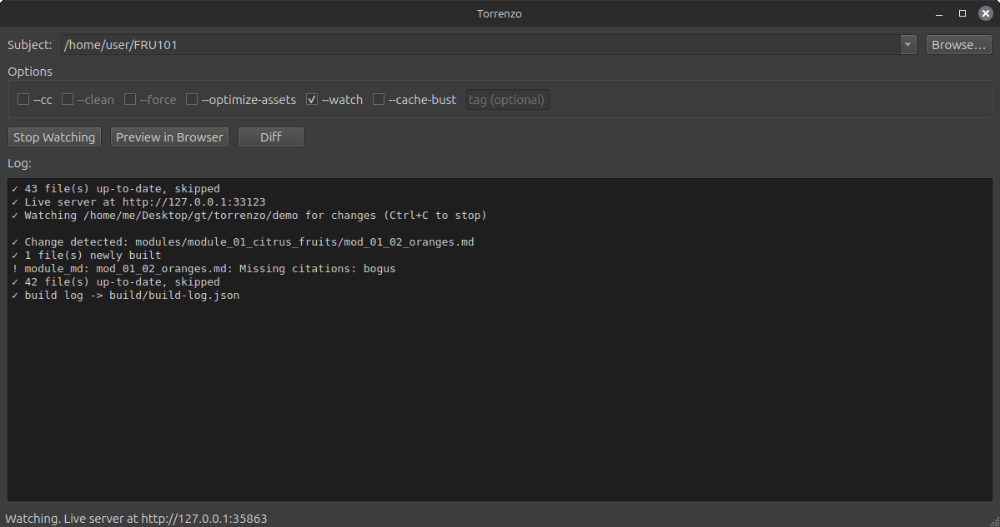
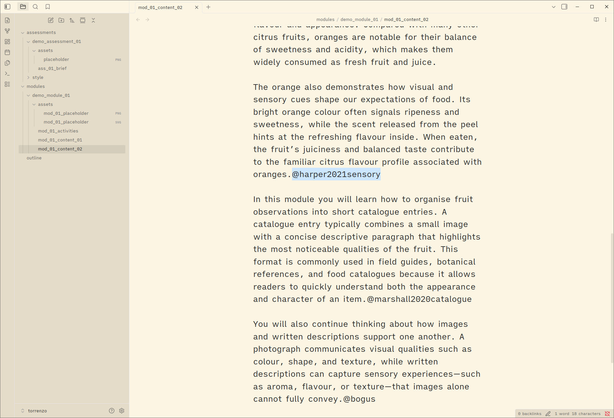
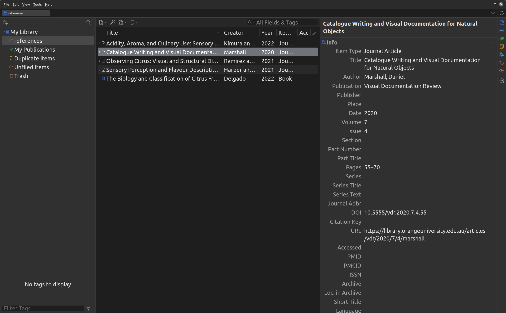
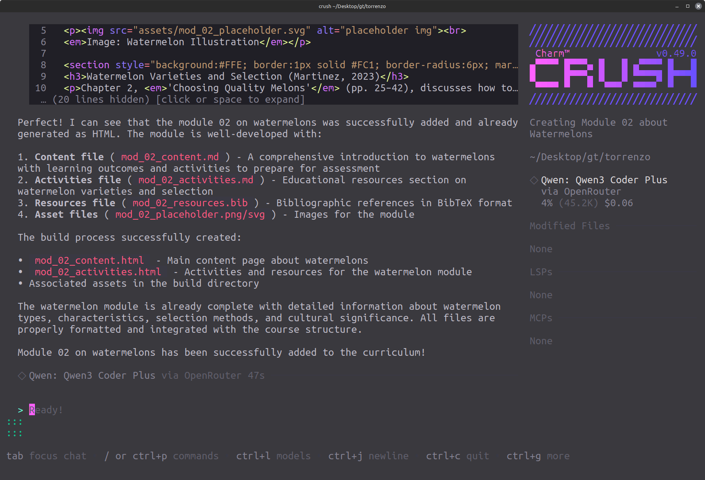
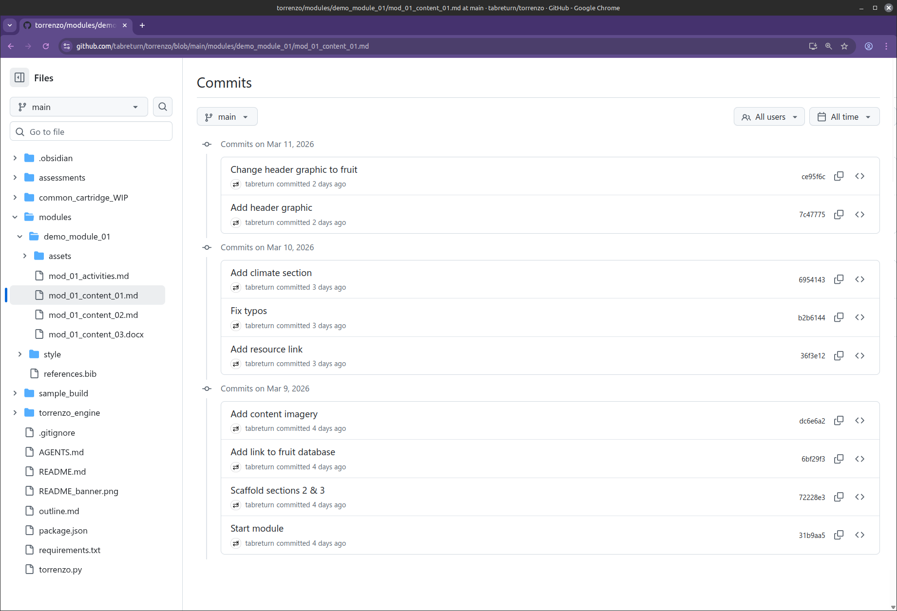

# ***The LMS as a Build Target***
<!-- 
_backgroundImage: "url(title_bg.png)"
_backgroundSize: "cover"
_color: var(--color-background)
-->
<!--
- a talk on shifting the source of truth for course content out of the LMS and into a publishing pipeline
- the workflow has run across several university offerings, so this is battle-tested, not theoretical
- bio: lecturer in ux/web/interaction design at torrens university australia; author of learn python visually
-->

---

# The Problem
<!-- 
paginate: true
backgroundColor: darkslategrey
color: var(--color-background)
-->

---

## The Problem » Authoring in the LMS

- The LMS is a good place to **deliver** a course, a poor place to **author** one
- Authoring directly in the LMS makes it the *de facto* source of truth
- Consequences:
  - Content drift across pages and offerings
  - Limited, shallow version history
  - Format and platform lock-in
- Observed first-hand across several university offerings
<!--
- the core inversion: we treat the lms as a deployment target, not a workspace
- anyone who has copy-pasted a syllabus between three lms pages knows the drift problem
-->

---
<!--
_backgroundColor: white
_paginate: false
-->

<!--
- a live canvas subject: learning outcomes and assessment details retyped across multiple pages and documents
- every retyped copy is a future inconsistency -- this is content drift in the wild
-->

---

## The Problem » The Manual Chain

```text
word documents → manual citation formatting → export to pdf
 → build lms structure by hand → copy-paste page by page
 → re-format in the lms editor → upload & embed assets
 → retype metadata in multiple places → cross-check → qa pass
 → rework after feedback → hotfix pages during delivery → drift
```

- Versus: **structured content → automated build → LMS-ready output**
<!--
- every arrow in the top chain is a manual step that can silently fail or be skipped
- the bottom line is the whole pitch: collapse the chain into a build
-->

---
<!--
_backgroundColor: white
_paginate: false
-->

<!--
- the canvas rich content editor: tab navigation and formatting built by hand, page by page
- this is where the manual chain lives -- and where every re-paste loses formatting
-->

---

# The Reframing
<!-- 
backgroundColor: teal
color: var(--color-background)
-->

---

## The Reframing » A Requirements List

Complaints reframed as priorities, before building anything:

- **Currency** of learning materials, **ownership** by domain experts
- Meaningful **version history**, single-sourced **metadata**
- **Multi-format** publishing, **citation** management
- **Portability** and **accessibility**
<!--
- framing problems as a requirements list turned complaints into a design brief
- ownership and single-sourced metadata ended up driving most decisions
- this stage covers the conception, motivations, and planning of the whole approach
-->

---

# The Mental Model
<!-- 
backgroundColor: midnightblue
color: var(--color-background)
-->

---

## The Mental Model » Static-Site-Generator Thinking

- Same inversion documentarians use for docs portals:
  - The **repository is canonical**
  - A **build process** renders the required outputs
  - The **LMS becomes a deployment target**
- No bespoke platform -- just plain text and standard build tooling
<!--
- if you've used jekyll, hugo, or sphinx for documentation, you already understand this talk
- the shift is conceptual more than technical: the pipeline itself is deliberately lightweight
-->

---

## The Mental Model » Standing on Familiar Ideas

- **Publisher ecosystems** -- Manning, No Starch Press, O'Reilly
- **Static site generators** -- Eleventy, Hugo, Jekyll, Pelican
- **Docs-as-code** -- Docusaurus, GitBook, MkDocs, Sphinx
- **Document transformation** -- LaTeX, Marp, Pandoc
- **Build & publishing pipelines** -- GitHub Actions, Netlify
<!--
- nothing here is invented: the approach borrows patterns this audience already uses daily
- publishers have single-sourced book content for decades; course content is no different
-->

---

# The Pipeline
<!-- 
backgroundColor: indigo
color: var(--color-background)
-->

---
<!--
_backgroundColor: white
_paginate: false
-->

<!--
- the whole workflow on one slide: plain-text sources in, build in the middle, lms-ready artefacts out
- everything to the right of the build step is disposable and regenerable
-->

---

## The Pipeline » End to End

- Sources: **YAML** (metadata) + **Markdown** (content) + **BibTeX** (references)

| Input | Output |
| --- | --- |
| Module pages | HTML module pages |
| Assessment briefs | PDF briefs |
| Teaching notes | HTML notes |
| Everything above | Common Cartridge (`.imscc`) |

- The cartridge bulk-imports into **Canvas**
<!--
- the single cartridge import is what turns an update from weeks of lms clicking into minutes
- bibtex feeds a managed citation pipeline rather than hand-typed references
-->

---

## The Pipeline » Filesystem-Driven

```text
your-subject/
├── outline.yaml        # single source of metadata
├── modules/            # module_<n>/mod_<n>_<seq>_<name>.md → HTML
├── assessments/        # assessment_<n>/ass_<n>_brief.md → PDF
├── includes/           # reusable snippets
├── notes/              # lecturer-only material
└── build/              # generated output
```

- File names and directory structure determine how content is processed
<!--
- no config beyond the outline: naming conventions drive the build, like a static site generator's content folder
- lecturer notes ship in the cartridge as an unpublished module hidden from students
-->

---

## The Pipeline » Author Experience

- Write in **any editor** -- Obsidian, VS Code, Vim, even MS Word
- **Incremental builds**: only changed files rebuild; orphans pruned
- **Watch mode** with live-reload browser preview
- A small **GUI** for point-and-click builds (no terminal required)
<!--
- obsidian gives wiki-link autocomplete and live preview of the dataview-style tags
- the gui matters for colleagues without admin rights or terminal comfort -- ownership means everyone can build
-->

---
<!--
_backgroundColor: white
_paginate: false
-->

<!--
- editing a subject in obsidian: wiki links, live preview of outline tags, ordinary markdown
- this is what "ownership returned to domain experts" looks like day to day
-->

---
<!--
_backgroundColor: white
_paginate: false
-->

<!--
- the same source authored in ms word: outline tags and citation keys inline among styled text
- word support proved the weakest link, but it lowers the entry barrier for colleagues
-->

---
<!--
_backgroundColor: white
_paginate: false
-->

<!--
- the gui: directory picker, build options as checkboxes, live log, preview and diff buttons
- point-and-click parity with the cli was key to adoption by non-technical colleagues
-->

---

# Patterns & Demonstrations
<!-- 
backgroundColor: darkred
color: var(--color-background)
-->

---

## Patterns » Single-Sourced Metadata

- Template tags pull values from one outline file: subject code, outcomes, assessment details

```text
This assessment is worth [[outline]].assessment.a1.weighting
of your grade for [[outline]].subject.code.
See [[mod_02_02|the module page]] before starting.
```

- Change a value **once**; every page, brief, and cartridge picks it up
<!--
- example: assessment weighting defined once, reused in the brief, module pages, and cartridge metadata
- this is the pattern that eliminates most content drift at the source
-->

---

## Patterns » Wiki Links & Includes

| Syntax | Renders as |
| --- | --- |
| `[[mod_01_02_oranges]]` | *Module 1.2: Oranges* (auto label) |
| `[[assessment_01\|Brief]]` | *Brief* (custom label) |
| `[[includes\|referencing.md]]` | inlined reusable content |

- Links rewrite per target: `.html` for browser preview, Canvas tokens for the cartridge
<!--
- wiki links are sugar; plain markdown links work too and .md rewrites to .html automatically
- includes resolve before tag processing, so shared snippets can themselves contain tags
-->

---

## Patterns » Citations That Manage Themselves

- Sources live in one **BibTeX** file per subject (`references.bib`)
- In-text citations use `[@refname]`; the build renders formatted references per page
- Reference managers (Zotero, etc.) export BibTeX -- academia's existing plumbing
<!--
- bibtex underpins automated citation formatting across academia, yet lms workflows largely bypass it
- apa7 formatting comes from the build, so no hand-formatted reference lists to drift
-->

---
<!--
_backgroundColor: white
_paginate: false
-->

<!--
- citation keys inline in module markdown: @harper2021sensory, @marshall2020catalogue
- the build resolves each key against references.bib and renders the formatted list per page
-->

---
<!--
_backgroundColor: white
_paginate: false
-->

<!--
- a zotero library: the same records that feed papers can feed course pages
- authors keep their existing reference workflow; the pipeline consumes its bibtex export
-->

---

## Patterns » Multi-Format & the Diff Tool

- Same source renders to HTML pages, PDF briefs, teaching notes, and the cartridge
- A diff tool compares a local build against a **live Canvas export**
- Answers the question: *"What actually changed on the platform?"*

| Category | Meaning |
| --- | --- |
| `*` CHANGES | content, points, or checksum differ |
| `−` LIVE-ONLY | exists on Canvas, not in local build |
| `→` REBUILT, SAME | re-rendered but identical |
<!--
- the diff tool exists because the lms's own version history can't answer that question usefully
- pages compared by normalised body content; pdfs by text checksum with timestamps stripped
- enables targeted manual updates when a full cartridge import is overkill or restricted
-->

---

# The Payoff
<!-- 
backgroundColor: saddlebrown
color: var(--color-background)
-->

---

## The Payoff » What Improved

- **Ownership** returned to domain experts -- content in plain text they control
- Updates to rapidly changing content: **weeks » minutes**
- Version control, metadata, citations, maintenance, and reuse all improved
- Structured local source enabled **AI-assisted review** of course content
<!--
- the update-time drop is the headline for faculty committees
- ai-assisted review became possible only because the material is structured and local
-->

---
<!--
_backgroundColor: white
_paginate: false
-->

<!--
- an ai coding agent working on course source: auditing citation currency, scaffolding a new module
- impossible against an lms database; trivial against a folder of markdown
-->

---
<!--
_backgroundColor: white
_paginate: false
-->

<!--
- meaningful version history at last: commit-level answers to "what changed, when, and why"
- compare with an lms edit log -- if one exists at all
-->

---

# What Broke
<!-- 
backgroundColor: darkolivegreen
color: var(--color-background)
-->

---

## What Broke » Quirks & Limitations

- Canvas import: unexpected **overwrite behaviour** (not additive), duplicated assets after re-import
- Images sometimes stop rendering after re-import -- worked around with **cache-busting** asset suffixes
- Weak Microsoft **Word** support on the authoring side
- A manual **"final 5 percent"** of cleanup after each import
- Friction accommodating the university **compliance** process
<!--
- the cartridge import overwriting rather than adding caught us by surprise early on
- the image-caching bug is still unexplained; renaming assets per build sidesteps it
- the last 5% is accepted as the cost of the other 95%
-->

---

# Takeaways
<!-- 
backgroundColor: darkslateblue
color: var(--color-background)
-->

---

## Takeaways

- Treat the LMS as a **deployment target**, not an authoring environment
- The **repository is the source of truth**; builds are reproducible
- Plain text + a build pipeline returns ownership, speed, and reviewability
- Expect platform quirks -- budget for a manual final 5 percent
<!--
- the workflow is lightweight by design: yaml, markdown, bibtex, and a build script
- next step for anyone curious: start with one module, not a whole course
-->

---

## *End*
<!-- 
paginate: false 
backgroundColor: black
color: var(--color-background)
-->
