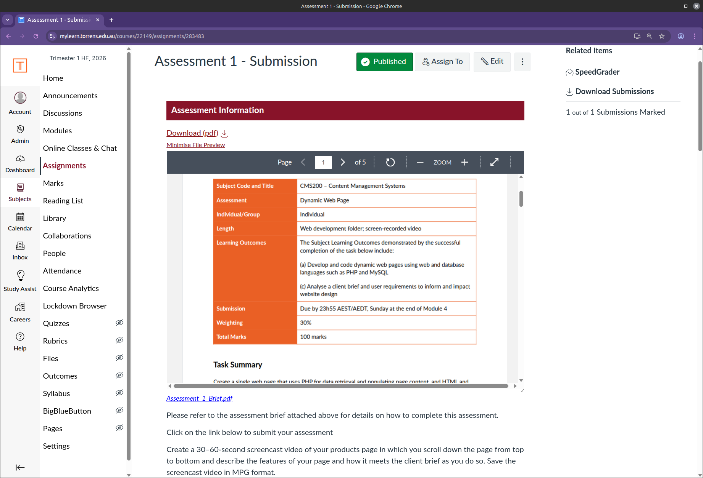
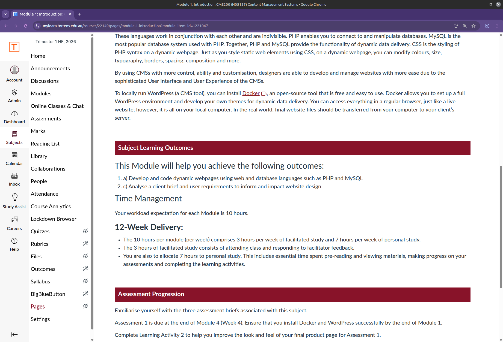
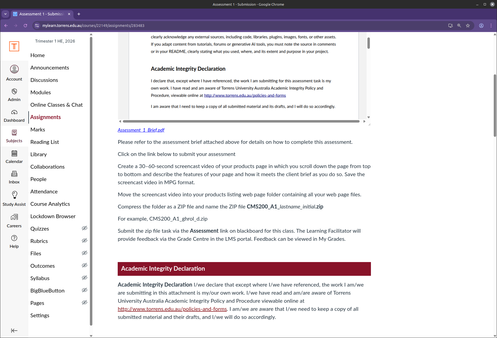
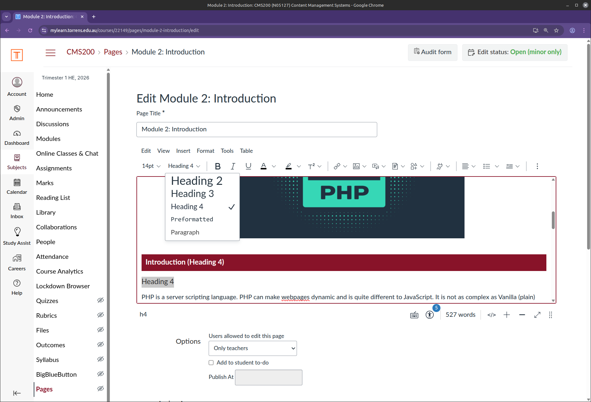
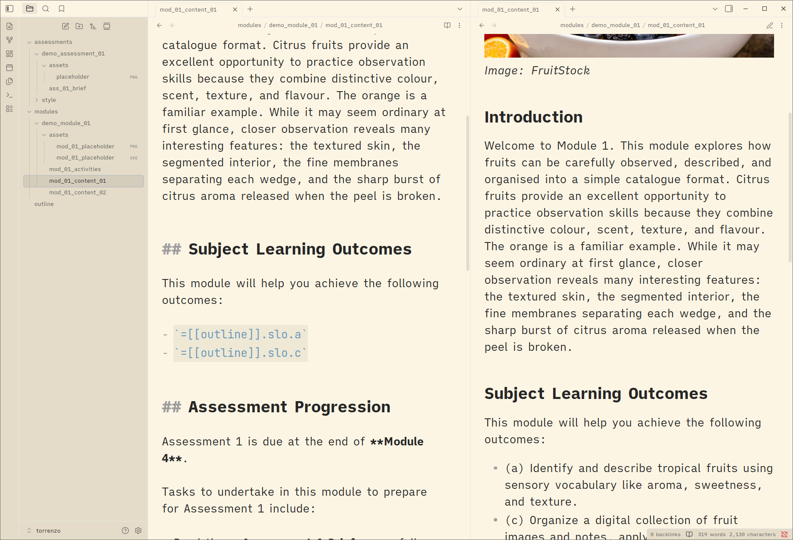
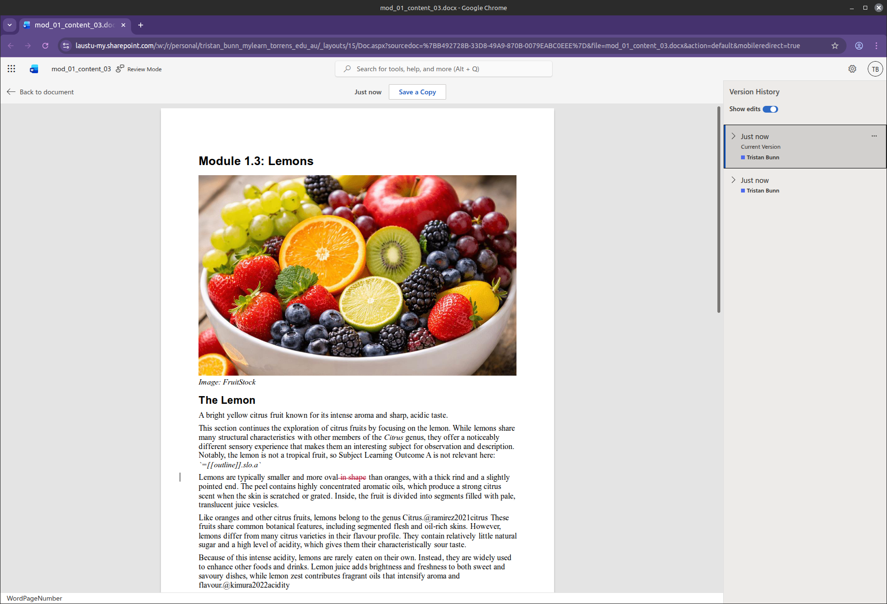
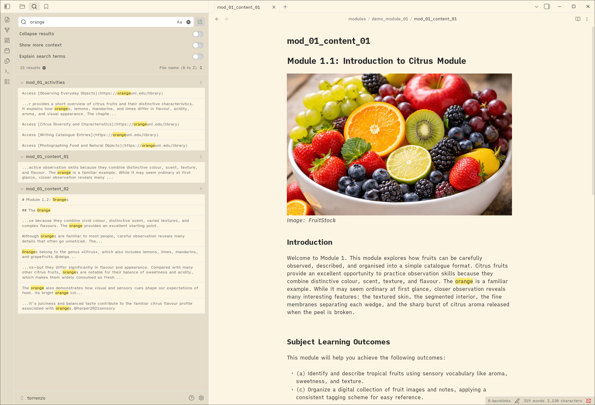

# ***The LMS as a Build Target***
<!-- 
_backgroundColor: black
_backgroundImage: "url(title_bg.png)"
_backgroundSize: "cover"
_color: var(--color-background)
-->
<!--
- a talk on shifting the source of truth for course content out of the LMS and into a publishing pipeline
- the workflow has run across several university offerings, so this is battle-tested, not theoretical
- bio: lecturer in ux/web/interaction design at torrens university australia; author of learn python visually
-->

---

# The Problem
<!-- 
paginate: true
backgroundColor: darkslategrey
color: var(--color-background)
-->

---

## The Problem » Authoring in the LMS

- The LMS is a good place to **deliver** a course, a poor place to **author** one
- Authoring directly in the LMS makes it the *de facto* source of truth
- Consequences:
  - Content drift across pages and offerings
  - Limited, shallow version history
  - Format and platform lock-in
- Observed first-hand across several university offerings
<!--
- the core inversion: we treat the lms as a deployment target, not a workspace
- anyone who has copy-pasted a syllabus between three lms pages knows the drift problem
-->

---
<!--
_backgroundColor: #EEE
_paginate: false
-->

> a live Canvas subject: spot the retyped details ...

<svg data-marpit-svg class="absolute">
  <rect x="437" y="280" width="385" height="55" style="fill:none;stroke:lime;stroke-width:5" />
</svg>
<!--
- a live canvas subject: learning outcomes and assessment details retyped across multiple pages and documents
- here: the assessment details on a module page
-->

---
<!--
_backgroundColor: #EEE
_paginate: false
-->


<svg data-marpit-svg class="absolute">
  <rect x="560" y="355" width="262" height="95" style="fill:none;stroke:lime;stroke-width:5" />
</svg>
<!--
- the same weighting and due date again, inside the embedded assessment brief pdf
-->

---
<!--
_backgroundColor: #EEE
_paginate: false
-->


<svg data-marpit-svg class="absolute">
  <rect x="358" y="363" width="518" height="40" style="fill:none;stroke:lime;stroke-width:5" />
</svg>
<!--
- the learning outcomes retyped once more on the module introduction page
-->

---
<!--
_backgroundColor: #EEE
_paginate: false
-->


<svg data-marpit-svg class="absolute">
  <rect x="428" y="138" width="405" height="110" style="fill:none;stroke:lime;stroke-width:5" />
  <rect x="359" y="540" width="545" height="143" style="fill:none;stroke:lime;stroke-width:5" />
</svg>
<!--
- the same declaration text duplicated in the pdf and the page body
- every retyped copy is a future inconsistency -- this is content drift in the wild
-->

---

## The Problem » The Manual Chain

```text
word documents → manual citation formatting → export to pdf
 → build lms structure by hand → copy-paste page by page
 → re-format in the lms editor → upload & embed assets
 → retype metadata in multiple places → cross-check → qa pass
 → rework after feedback → hotfix pages during delivery → drift
```

<hr style="color:rgba(255,255,255,0.3)" />

```text
structured content → automated build → lms-ready output
```
<!--
- every arrow in the top chain is a manual step that can silently fail or be skipped
- the bottom line is the whole pitch: collapse the chain into a build
-->

---
<!--
_backgroundColor: #EEE
_paginate: false
-->

> the Canvas rich content editor: built by hand, page by page
<!--
- the canvas rich content editor: tab navigation and formatting built by hand, page by page
- this is where the manual chain lives -- and where every re-paste loses formatting
-->

---
<!--
_backgroundColor: #EEE
_paginate: false
-->

> hand-formatting, heading by heading, in the LMS editor
<!--
- every heading, list, and table styled by hand in the rich content editor
- repeat for every page, every offering -- and again after every paste
-->

---

# The Reframing
<!-- 
backgroundColor: teal
color: var(--color-background)
-->

---

## The Reframing » A Requirements List

*Complaints reframed as priorities, before building anything ...*

* <highlight>Currency</highlight> of learning materials, <highlight>ownership</highlight> by domain experts
* Meaningful <highlight>version history</highlight>, single-sourced <highlight>metadata</highlight>
* <highlight>Multi-format</highlight> publishing, <highlight>citation</highlight> management
* <highlight>Portability</highlight> and <highlight>accessibility</highlight>
<!--
- framing problems as a requirements list turned complaints into a design brief
- ownership and single-sourced metadata ended up driving most decisions
- this stage covers the conception, motivations, and planning of the whole approach
-->

---

## The Reframing » What If ...

Instead of wrangling Word documents and repeatedly copy-pasting into the LMS editor, we:

<highlight>write content once, in structured source files</highlight>
then
<!--
- the pivotal "what if" moment, before any tooling existed ... [NEXT SLIDE]
-->

---

## The Reframing » What If ...

Instead of wrangling Word documents and repeatedly copy-pasting into the LMS editor, we:

<highlight>write content once, in structured source files</highlight>
then
<highlight>automatically generate:</highlight>

- 📘 LMS module pages
- 📄 assessment briefs
- 📑 formatted references
- ✨ and more
<!--
- "automatically" here means functionally, reliably, and usably generated
- this question is the whole talk in one slide; everything after is implementation
-->

---

# The Mental Model
<!-- 
backgroundColor: midnightblue
color: var(--color-background)
-->

---

## The Mental Model » Static-Site-Generator Thinking

- Same inversion documentarians use for docs portals:
  - The **repository is canonical**
  - A **build process** renders the required outputs
  - The **LMS becomes a deployment target**
- No bespoke platform -- just plain text and standard build tooling
<!--
- if you've used jekyll, hugo, or sphinx for documentation, you already understand this talk
- the shift is conceptual more than technical: the pipeline itself is deliberately lightweight
-->

---

## The Mental Model » Standing on Familiar Ideas

* <highlight>Publisher ecosystems:</highlight> Manning, No Starch Press, O'Reilly
* <highlight>Static site generators:</highlight> Eleventy, Hugo, Jekyll, Pelican
* <highlight>Docs-as-code:</highlight> Docusaurus, GitBook, MkDocs, Sphinx
* <highlight>Document transformation:</highlight> LaTeX, Marp, Pandoc
* <highlight>Build & publishing pipelines:</highlight> GitHub Actions, Netlify
<!--
- nothing here is invented: the approach borrows patterns this audience already uses daily
- publishers have single-sourced book content for decades; course content is no different
-->

---

# The Pipeline
<!-- 
backgroundColor: indigo
color: var(--color-background)
-->

---
<!--
_backgroundColor: #EEE
_paginate: false
-->

> sources in, build in the middle, LMS-ready artefacts out
<!--
- the whole workflow on one slide: plain-text sources in, build in the middle, lms-ready artefacts out
- everything to the right of the build step is disposable and regenerable
-->

---

## The Pipeline » End to End

- Sources: **YAML** (metadata) + **Markdown** (content) + **BibTeX** (references)

| Input | Output |
| --- | --- |
| Module pages | HTML module pages |
| Assessment briefs | PDF briefs |
| Teaching notes | HTML notes |
| Everything above | Common Cartridge (`.imscc`) |

- The cartridge bulk-imports into **Canvas**
<!--
- the single cartridge import is what turns an update from weeks of lms clicking into minutes
- bibtex feeds a managed citation pipeline rather than hand-typed references
-->

---

## The Pipeline » Filesystem-Driven

```text
your-subject/
├── outline.yaml        # single source of metadata
├── modules/            # module_<n>/mod_<n>_<seq>_<name>.md → HTML
├── assessments/        # assessment_<n>/ass_<n>_brief.md → PDF
├── includes/           # reusable snippets
├── notes/              # lecturer-only material
└── build/              # generated output
```

- File names and directory structure determine how content is processed
<!--
- no config beyond the outline: naming conventions drive the build, like a static site generator's content folder
- lecturer notes ship in the cartridge as an unpublished module hidden from students
-->

---

## The Pipeline » Author Experience

* <highlight>Any editor:</highlight> Obsidian, VS Code, Vim, even MS Word
* <highlight>Incremental builds:</highlight> only changed files rebuild; orphans pruned
* <highlight>Watch mode:</highlight> live-reload browser preview
* <highlight>GUI:</highlight> point-and-click builds (no terminal required)
<!--
- obsidian gives wiki-link autocomplete and live preview of the dataview-style tags
- the gui matters for colleagues without admin rights or terminal comfort -- ownership means everyone can build
-->

---
<!--
_backgroundColor: #EEE
_paginate: false
-->

> editing a subject in Obsidian: wiki links, tags, plain Markdown
<!--
- editing a subject in obsidian: wiki links, live preview of outline tags, ordinary markdown
- this is what "ownership returned to domain experts" looks like day to day
-->

---
<!--
_backgroundColor: #EEE
_paginate: false
-->

> source mode (tags visible) vs reading view (tags resolved)
<!--
- left: raw source with [[outline]] tags; right: obsidian's reading view resolving them live
- authors see populated outcomes and metadata while writing, before any build runs
-->

---
<!--
_backgroundColor: #EEE
_paginate: false
-->

> the same source, authored in MS Word
<!--
- the same source authored in ms word: outline tags and citation keys inline among styled text
- word support proved the weakest link, but it lowers the entry barrier for colleagues
-->

---
<!--
_backgroundColor: #EEE
_paginate: false
-->

> even Word authors get version history on tagged source
<!--
- word online's version history over a tagged .docx source file
- tags survive the word round-trip, so office-bound colleagues still feed the same pipeline
-->

---
<!--
_backgroundColor: #EEE
_paginate: false
-->

> the GUI: point-and-click parity with the CLI
<!--
- the gui: directory picker, build options as checkboxes, live log, preview and diff buttons
- point-and-click parity with the cli was key to adoption by non-technical colleagues
-->

---

# Patterns & Demonstrations
<!-- 
backgroundColor: darkred
color: var(--color-background)
-->

---

## Patterns » Single-Sourced Metadata

- Remember the drift screenshot? **Every retyped value becomes a tag**
- Tags pull values from one outline file: subject code, outcomes, assessment details

```text
This assessment is worth [[outline]].assessment.a1.weighting
of your grade for [[outline]].subject.code.
See [[mod_02_02|the module page]] before starting.
```

- Change a value **once**; every page, brief, and cartridge picks it up
<!--
- direct callback to the content-drift slide: the retyped weighting/outcomes are exactly what tags replace
- example: assessment weighting defined once, reused in the brief, module pages, and cartridge metadata
- this is the pattern that eliminates most content drift at the source
-->

---

## Patterns » One Syntax, Five Jobs

* <highlight>Outline values:</highlight> `[[outline]].assessment.a1.weighting`
* <highlight>Links & includes:</highlight> `[[mod_02_02|the module page]]`, `[[includes|referencing.md]]`
* <highlight>Module values:</highlight> `[[module|n.n]]`, `[[module|name]]` -- from the filesystem
* <highlight>Components:</highlight> `[[component.module-navigation]]`, `[[component.video|clip.mp4]]`
* <highlight>Citations:</highlight> `[@harper2021sensory]` -- resolved against BibTeX
<!--
- the key insight: one wiki-link syntax unifies metadata, linking, reuse, layout, and citations
- it's obsidian's wiki-link syntax, so authors get autocomplete and live preview for free
- no new language to learn: if you can write a wiki link, you can use every feature
-->

---

## Patterns » Tags Resolve by Shape

From a real assessment brief -- even the H1 is a tag:

```text
# [[outline]].assessment.a1.assessment

[[outline]].assessment.a1
```

- A **value** (`.weighting`) renders as a plain string
- An **object** (`.a1`) renders as a metadata table of all its fields
- A **list** (`[[outline]].slo`) renders as the full outcomes list
<!--
- same syntax, different output: the build looks at what the path points to and renders accordingly
- the brief's own title and its due-date/weighting table are never typed by hand
- change the weighting in outline.yaml and the brief, module pages, and cartridge all update
-->

---

## Patterns » The Filesystem Numbers the Course

```text
modules/module_07_data_shaping/mod_07_02_pre-class.md

# Module [[module|n.n]]: [[module|name]]
```

renders as ...

```text
# Module 7.2: Data Shaping
```

- Numbering, titles, and navigation derive from directory and file names
- Reordering modules is a `git mv` -- every heading, cross-reference, and nav updates itself
<!--
- the most surprising payoff for docs people: no module number is ever typed in content
- weekly-to-modular restructures, inserting a module mid-course: rename directories, rebuild, done
-->

---

## Patterns » Wiki Links & Includes

| Syntax | Renders as |
| --- | --- |
| `[[mod_01_02_oranges]]` | *Module 1.2: Oranges* (auto label) |
| `[[assessment_01\|Brief]]` | *Brief* (custom label) |
| `[[includes\|referencing.md]]` | inlined reusable content |

- Links rewrite per target: `.html` for browser preview, Canvas tokens for the cartridge
<!--
- wiki links are sugar; plain markdown links work too and .md rewrites to .html automatically
- includes resolve before tag processing, so shared snippets can themselves contain tags
- auto labels come from the same filesystem derivation as module numbering
-->

---

## Patterns » Citations That Manage Themselves

- Sources live in one **BibTeX** file per subject (`references.bib`)
- In-text citations use `[@refname]`; the build renders formatted references per page
- Reference managers (Zotero, etc.) export BibTeX -- academia's existing plumbing
<!--
- bibtex underpins automated citation formatting across academia, yet lms workflows largely bypass it
- apa7 formatting comes from the build, so no hand-formatted reference lists to drift
-->

---
<!--
_backgroundColor: #EEE
_paginate: false
-->

> citation keys inline in module Markdown
<!--
- citation keys inline in module markdown: @harper2021sensory, @marshall2020catalogue
- the build resolves each key against references.bib and renders the formatted list per page
-->

---
<!--
_backgroundColor: #EEE
_paginate: false
-->

> a Zotero library; the pipeline consumes its BibTeX export
<!--
- a zotero library: the same records that feed papers can feed course pages
- authors keep their existing reference workflow; the pipeline consumes its bibtex export
-->

---

## Patterns » Multi-Format & the Diff Tool

- Same source renders to HTML pages, PDF briefs, teaching notes, and the cartridge
- A diff tool compares a local build against a **live Canvas export**
- Answers the question: *"What actually changed on the platform?"*

| Category | Meaning |
| --- | --- |
| `*` CHANGES | content, points, or checksum differ |
| `−` LIVE-ONLY | exists on Canvas, not in local build |
| `→` REBUILT, SAME | re-rendered but identical |
<!--
- the diff tool exists because the lms's own version history can't answer that question usefully
- pages compared by normalised body content; pdfs by text checksum with timestamps stripped
- enables targeted manual updates when a full cartridge import is overkill or restricted
-->

---

# Around the Pipeline
<!-- 
backgroundColor: seagreen
color: var(--color-background)
-->
<!--
- a build pipeline attracts small utility scripts that automate the fiddly edges
-->

---

## Around the Pipeline » Utility Scripts

* <highlight>Procedural graphics:</highlight> per-module banner SVGs and course images,  
  generated from a script -- one palette per subject
* <highlight>Word sync:</highlight> planner/outline `.docx` updated from `outline.yaml`,  
  editing tracked changes in place
* <highlight>PDF conversion:</highlight> outline/planner documents rendered via headless LibreOffice
* <highlight>Video covers:</highlight> a 2-second title slide muxed onto every module video,  
  title derived from the filename
<!--
- small scripts, same philosophy: the source of truth generates everything downstream
- word sync matters for compliance: the university process wants .docx with tracked changes
- video covers are idempotent -- a metadata marker means re-runs skip processed files
-->

---
<!--
_backgroundColor: #EEE
_paginate: false
-->


<!--
- procedurally generated module banners: pixel-raster font, per-subject palette, seeded randomness
- every module page gets a unique banner with zero design time
-->

---
<!--
_backgroundColor: #EEE
_paginate: false
-->

> procedural course images: a rotated geometric pattern per subject
<!--
- the lms course tile, also generated -- same palette system as the banners
- rerun with a new seed for a fresh set; consistency without a designer in the loop
-->

---

# The Payoff
<!-- 
backgroundColor: saddlebrown
color: var(--color-background)
-->

---

## The Payoff » What Improved

* <highlight>Ownership:</highlight> returned to domain experts -- plain text they control
* <highlight>Speed:</highlight> updates to rapidly changing content, **weeks » minutes**
* <highlight>Maintenance:</highlight> version control, metadata, citations, and reuse all improved
* <highlight>AI-assisted review:</highlight> enabled by structured, local source material

<smaller>There is room for more or less automation -- the pipeline can be calibrated per subject and team.</smaller>
<!--
- the update-time drop is the headline for faculty committees
- ai-assisted review became possible only because the material is structured and local
- the pipeline isn't all-or-nothing: teams dial automation up or down per subject
-->

---

## The Payoff » A Complete, Local Project

- **Search everything** -- file manager, editor, or `grep` across all source
- **Automated and batch checks** -- broken links, missing citations, orphans
- **AI review** -- flag outdated content, references, or material needing clarity
<!--
- none of this is possible when content lives inside an lms database
- the build already reports missing citations and orphaned files on every run
-->

---
<!--
_backgroundColor: #EEE
_paginate: false
-->

> one search across every module, activity, and brief
<!--
- obsidian global search for "orange" across the whole subject in milliseconds
- compare: searching an lms means clicking into every page
-->

---
<!--
_backgroundColor: #EEE
_paginate: false
-->

> an AI coding agent working directly on course source
<!--
- an ai coding agent working on course source: auditing citation currency, scaffolding a new module
- impossible against an lms database; trivial against a folder of markdown
-->

---
<!--
_backgroundColor: #EEE
_paginate: false
-->

> commit-level answers to "what changed, when, and why"
<!--
- meaningful version history at last: commit-level answers to "what changed, when, and why"
- compare with an lms edit log -- if one exists at all
-->

---

# What Broke
<!-- 
backgroundColor: darkolivegreen
color: var(--color-background)
-->

---

## What Broke » Quirks & Limitations

* <highlight>Canvas import:</highlight> unexpected overwrite behaviour (not additive),  
  duplicated assets after re-import
* <highlight>Image caching:</highlight> images sometimes stop rendering after re-import;  
  worked around with cache-busting asset suffixes
* <highlight>Word support:</highlight> weak on the authoring side
* <highlight>Final 5 percent:</highlight> manual cleanup after each import
* <highlight>Compliance:</highlight> friction accommodating the university process
<!--
- the cartridge import overwriting rather than adding caught us by surprise early on
- the image-caching bug is still unexplained; renaming assets per build sidesteps it
- the last 5% is accepted as the cost of the other 95%
-->

---

# Takeaways
<!-- 
backgroundColor: darkslateblue
color: var(--color-background)
-->

---

## Takeaways

* Treat the LMS as a <highlight>deployment target</highlight>, not an authoring environment
* The <highlight>repository is the source of truth</highlight>; builds are reproducible
* Plain text + a build pipeline returns <highlight>ownership, speed, and reviewability</highlight>
* Expect platform quirks -- budget for a manual final 5 percent
<!--
- the workflow is lightweight by design: yaml, markdown, bibtex, and a build script
- next step for anyone curious: start with one module, not a whole course
-->

---

## *End*
<!-- 
paginate: false 
backgroundColor: black
color: var(--color-background)
-->
