---

marp: true
theme: TorrensUni
notes: ...

---

# ***The LMS as a Build Target***
<!--
_backgroundColor: black
_backgroundImage: "url(title_bg.png)"
_backgroundSize: "cover"
color: var(--color-background)
-->
<!--
- shifting the source of truth for course content out of the LMS and into a publishing pipeline
-->

---

# Introductions
<!-- 
paginate: true
backgroundColor: darkslategrey
-->

---

## Introductions » Myself
* Interactive media lecturer
* Designer → developer → creative/design technologist
* Industry experience in startups, multimedia studios, web departments
* Learning development, authoring, geekery

---

<!--
_backgroundColor: black
_paginate: false
-->

> tabreturn.com
<!--
- if you'd like to view more of my work, check out my portfolio website
-->

---

## Introductions » You?
* Who has worked with an LMS (Learning Management System)?
* Blackboard, Canvas, D2L, Moodle, ... ?
* 360Learning, Absorb, Docebo, TalentLMS, ... ?
* Learning designers or educators?
* <svg data-marpit-svg class="absolute">
    <rect x="300" y="235" width="124" height="49" style="fill:none;stroke:lime;stroke-width:5" />
  </svg>
<!--
- note that i'm familiar with solutions popular in secondary/tertiary education
- this talk specifically concerns [CLICK] canvas ... [NEXT 2 SLIDES]
-->

---

<!--
_backgroundColor: #EEE
_paginate: false
-->
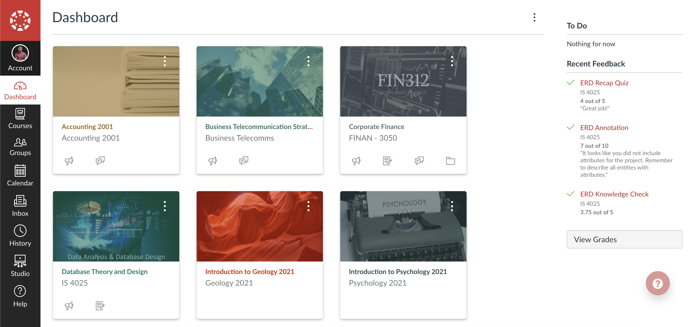
> canvas lms
<!--
- provides students a single, unified hub across every course they take
- built-in cms for editing materials; as well as grading features, analytics, and more
- you may have heard of it from the 2026 canvas data breach ...
- over 8,000 educational institutions
- (inc. many notable australian unis, princeton, harvard, ...)
-->

---

<!--
_backgroundColor: #EEE
_paginate: false
-->

> canvas lms
* <svg data-marpit-svg class="absolute">
    <rect x="112" y="140" width="165" height="235" style="fill:none;stroke:lime;stroke-width:5" />
  </svg>
* <svg data-marpit-svg class="absolute">
    <rect x="1011" y="140" width="231" height="478" style="fill:none;stroke:lime;stroke-width:5" />
  </svg>
<!--
- typical course page
- note [CLICK] left column for main navigation, and right column [CLICK] listing assessment deadlines
-->

---

<!--
_backgroundColor: #EEE
_paginate: false
-->
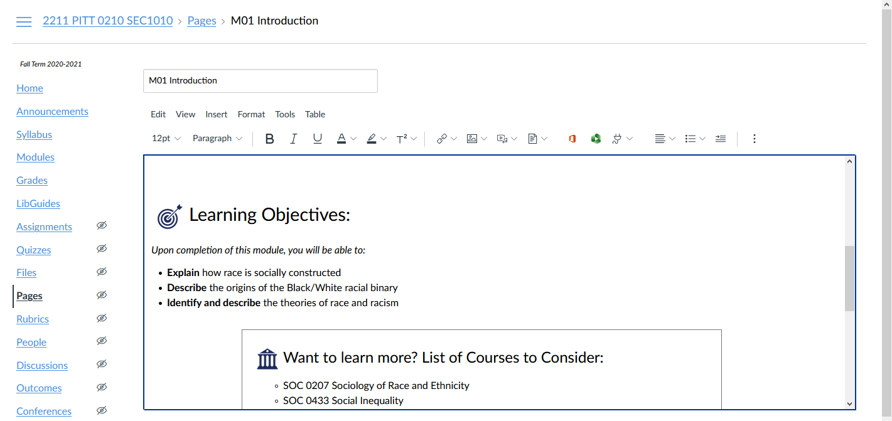
> canvas lms
<!--
- as far as editing goes, it's your standard wysiwyg / rich-text editor affair
- note that editing is a per-page exercise
-->

---


# The Problem(s)
<!-- 
paginate: true
backgroundColor: maroon
-->
<!--
- i started to look at reworking courses --
- i'll discuss issues obvious at first glance shortly, but --
- i reached conclusion ... [NEXT SLIDE]
-->

---

## The Problem(s) » Talk Premise
### *The (Canvas) LMS is a good place to <highlight>deliver</highlight> a course, <br />but a poor place to <highlight>author</highlight> one.*
<!--
- have to caveat that with ... [NEXT SLIDE]
-->

---

## The Problem(s) » Talk Premise
### *The (Canvas) LMS is a good place to <highlight>deliver</highlight> a course, <br />but a poor place to <highlight>author</highlight> one.*
<p>&nbsp;</p>
<smaller>⚠️<br />At least, this seemed obvious to somebody with some experience working on digital products, popular project documentation systems, LaTeX, static-site-generators, etc.</smaller>
<!--
- and another caveat ... [NEXT SLIDE]
-->

---

## The Problem(s) » Talk Premise
### *The (Canvas) LMS is a good place to <highlight>deliver</highlight> a course, <br />but a poor place to <highlight>author</highlight> one.*
<p>&nbsp;</p>
<smaller>⚠️<br />At least, this seemed obvious to somebody with some experience working on digital products, popular project documentation systems, LaTeX, static-site-generators, etc.</smaller>
<br /><br />
<smaller>⚠️<br />Third-party Canvas plugins (LTIs) likely address some of my gripes, but require institutional licensing (see money) and IT sign-off, which is prohibitive.</smaller>

---

## The Problem(s) » Immediate Concerns ...

* <highlight>`1.` Content Drift</highlight>  
  No imports, variables, or shared blocks to stay in sync
* <highlight>`2.` Siloed Pages</highlight>  
  'Keyhole' editing, no narrative view, massive click-tax
* <highlight>`3.` Form Torture</highlight>  
  Example: clicking tiny boxes and dropdowns to build rubrics
<!--
- keyhole editing: u.x metaphor borrowed from joke about painting a hallway through the letterbox/keyhole
-->

---

## The Problem(s) » Immediate Concerns ...
- <highlight>`1.` Content Drift</highlight>  
  No imports, variables, or shared blocks to stay in sync
- <highlight>`2.` Siloed Pages</highlight>  
  'Keyhole' editing, no narrative view, massive click-tax
- <highlight>`3.` Form Torture</highlight>  
  Example: clicking tiny boxes and dropdowns to build rubrics

<p>&nbsp;</p>
<smaller>Furthermore: browser-bound workflow, link rot, hostile to AI/CLI work, shallow version history, general lack of automation ... And, the LMS ends up the de facto source of truth -- but not really.</smaller>
<!--
- browser-bound: slow reloads, constant tab-juggling, zero offline work
- link rot: swapping files breaks links or serves stale cached copies
- hostile to a.i/c.l.i: database silos block local editors, scripts, and agents
- source of truth but not really: pdf source documents really on ms word
- but, let me run through some examples ... [NEXT SLIDE]
-->

---

# 1. Content Drift
<!-- 
paginate: true
backgroundColor: rebeccapurple
-->

---

<!--
_backgroundColor: #EEE
_paginate: false
-->
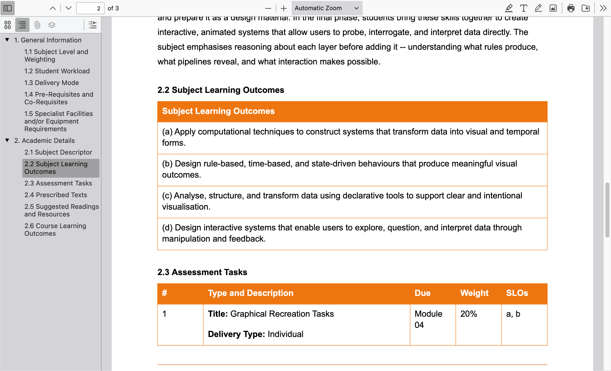
> pyf200 course
* <svg data-marpit-svg class="absolute">
    <rect x="405" y="260" width="622" height="51" style="fill:none;stroke:lime;stroke-width:5" />
  </svg>
* <svg data-marpit-svg class="absolute">
    <rect x="952" y="550" width="74" height="65" style="fill:none;stroke:lime;stroke-width:5" />
  </svg>
<!--
- anybody familiar with these kind of documents? explain ...
- subject learning outcomes necessary for "constructive alignment" and "curriculum mapping", etc.
- for example lets focus on s.l.o (a) [CLICK]
- every single assessment brief [CLICK], grading rubric, module, etc. maps to these ... [NEXT SLIDE]
-->

---

<!--
_backgroundColor: #EEE
_paginate: false
-->
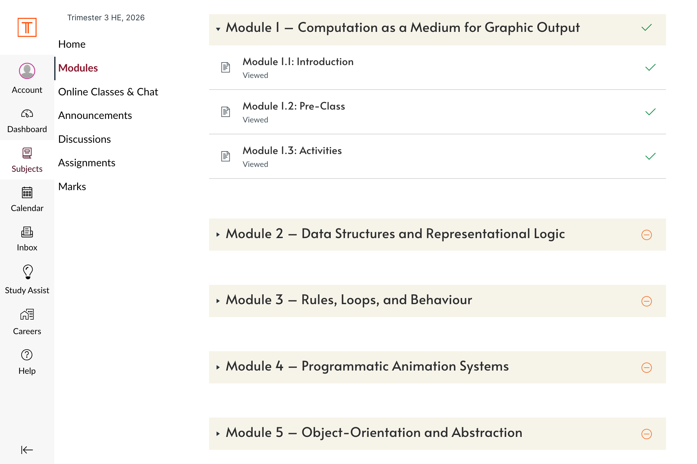
> pyf200 course
* <svg data-marpit-svg class="absolute">
    <ellipse cx="620" cy="147" rx="20" ry="20" stroke-dasharray="3" style="fill:none;stroke:lime;stroke-width:5" />
  </svg>
<!--
- here's the thing -- there are usually 12 modules ...
- and each intro sub-module lists its s.l.o mappings
- lets [CLICK] navigate the first ... [NEXT SLIDE]
-->

---

<!--
_backgroundColor: #EEE
_paginate: false
-->

> pyf200 course
* <svg data-marpit-svg class="absolute">
    <rect x="470" y="546" width="560" height="46" style="fill:none;stroke:lime;stroke-width:5" />
  </svg>
<!--
- note [CLICK] our friend s.l.o (a) mapped as a module outcome
- note it doesn't list all four -- ...
- different slo items map to different modules
-->

---

<!--
_backgroundColor: #EEE
_paginate: false
-->
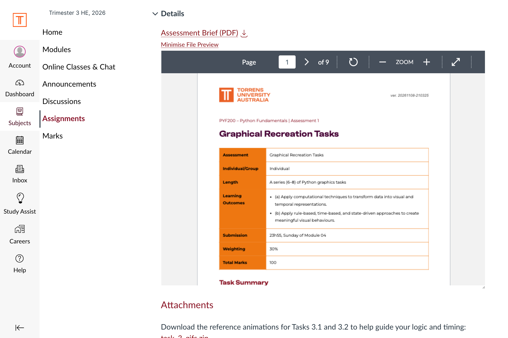
> pyf200 course
* <svg data-marpit-svg class="absolute">
    <rect x="660" y="397" width="288" height="33" style="fill:none;stroke:lime;stroke-width:5" />
  </svg>
<!--
- what's more: there are different s.l.o mappings for different assessment briefs
- which are (as you might have guessed from the screenshot) embedded pdf documents
-->

---

## 1. Content Drift » Scenario
### *Somebody needs a change to SLO (a) --*
* Make official change to the learning outline
* Update (potentially) 12 module Intro instances ...
* And to find these, you'll need to click through every module
* Then, update (potentially) 3 assessment briefs ...
* But recall those briefs are MS Word documents ...
* That then require re-exporting as PDF, and uploading ...
* Only for caching to display the old version.
<!--
- of course, you can rename the pdf, but what other links does that break?
-->

---

# 2. Siloed Pages
<!-- 
paginate: true
backgroundColor: darkgreen
-->
<!--
- recall: keyhole editing, no narrative view, massive click-tax ...
- this also affects styling! ... [NEXT SLIDE]
-->

---

<!--
_backgroundColor: #EEE
_paginate: false
-->
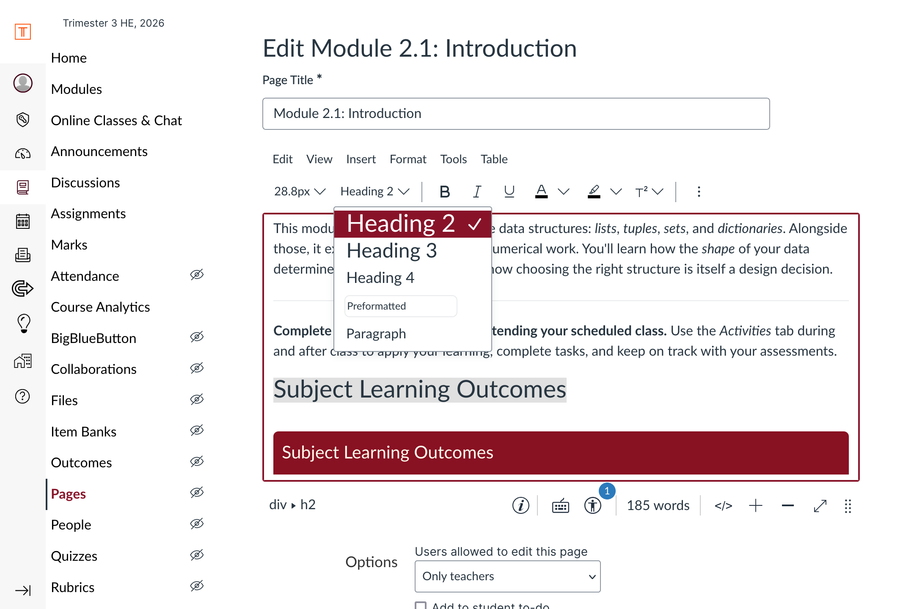
<!--
- the default headings require further styling ...
- admittedly, the global stylesheet thing is on us
- in defense, this content has been migrated from another l.m.s, changing template designs, etc.
- but, there are always bespoke elements that require uniform styling ... [NEXT SLIDE]
-->
> pyf200 course

---

<!--
_backgroundColor: #EEE
_paginate: false
-->
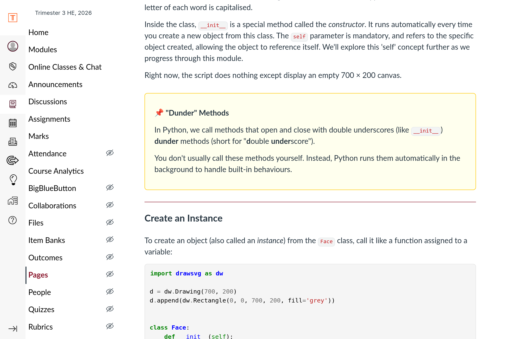
<!--
- like these callout notes, for example
- let's consider 2 scenarios ... [NEXT SLIDE]
-->
> pyf200 course

---

## 2. Siloed Pages » Scenario 1
### *All callout boxes require a different background colour --*
* Open a page and visually scan for these elements ...
* (alternatively, open the WYSIWYG HTML view and search the source)
* Then apply new styling manually
* Open the next page and repeat (potentially 12 × 3 times).

---

## 2. Siloed Pages » Scenario 2
### *All instances of the term "Twitter" need replacing --*
* Open a page and search for "Twitter" and replace with "X" ...
* Open the next page and repeat (potentially 12 × 3 times)
* Then, update (potentially) 3 assessment briefs ...
* But those briefs are MS Word documents ...
* That then require re-exporting as PDF, and uploading.
<!--
- and on last point: don't forget caching challenges
-->

---

# 3. Form Torture
<!-- 
paginate: true
backgroundColor: indigo
color: var(--color-background)
-->

---

<!--
_backgroundColor: #EEE
_paginate: false
-->
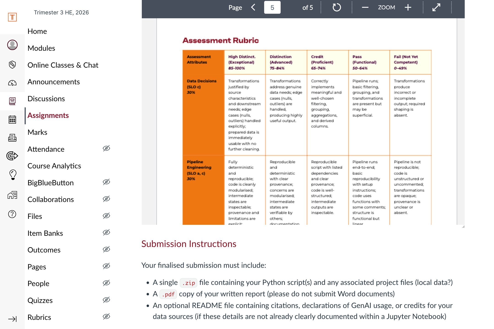
> pyf200 assessment pdf
<!---
- recall that assessment briefs are embedded pdf files
- each assessment includes a grading rubric ... [NEXT]
-->

---

<!--
_backgroundColor: #EEE
_paginate: false
-->

> canvas rubric
<!---
- but the grading system is part of the l.m.s configuration, and ...
- dealing with l.m.s grading rubrics is a fiddly affair
- critical: you cannot edit them  after the submission date --
- need to be accurate and consistent
-->

---

## 3. Form Torture » Scenario
### *Assessment 1 rubric requires an additional criterion --*
* Locate the relevant brief source document (MS Word)
* Make the change, then re-export as PDF and upload
* (Don't forget caching might bite you in the butt)
* Now manually edit the corresponding Canvas rubric (fiddly business).

---

# Solution
<!-- 
backgroundColor: darkcyan
color: var(--color-background)
-->
<!--
- with some introduction to the problems covered, let's look at the solution
-->

---

## Solution » What If ...
<hr style="border:none;border-top:1px solid #EEE" />

<larger>***The LMS is just a build target?***</larger>

<hr style="border:none;border-top:1px solid #EEE" /><br />

* <highlight>Write content once</highlight> in structured source files
* <highlight>Automatically generate</highlight> LMS module pages, assessment briefs, ...
* Need a change? Edit those source materials, rebuild, re-upload.

---

## Solution » Mental Model

Same inversion documentarians use for modern docs portals --
* The (Git?) repository is the *source of truth*
* A build step *renders the outputs*
* The website is just a *deployment target*
<!--
- and of specific inspiration to me was ... [NEXT SLIDE]
-->

---

## Solution » SSG-Inspired Pipeline
<h3><highlight>Static Site Generators</highlight></h3>
<!--
- (in case anybody is not aware) ... [NEXT SLIDE]
-->

---

## Solution » SSG-Inspired Pipeline
<h3><highlight>Static Site Generators</highlight></h3>

*Takes a folder of plain-text files (usually Markdown + templates & config) and compiles them into a clean, fast HTML website -- no database or browser WYSIWYG required.*

<hr style="border:none;border-top:1px solid #EEE" />

* **General / Blogs**  
  *Astro, Hugo, Jekyll, Eleventy, ...*
* **Docs / Guides**  
  *MkDocs, Docusaurus, Starlight (by Astro), ...*
<!---
- fun fact: i fell hard for s.s.g back when github pages introduced jekyll
-->

---

<!--
_backgroundColor: #EEE
_paginate: false
-->
> generated with mermaid

<svg data-marpit-svg class="absolute">
  <defs>
    <linearGradient id="fade-horiz" x1="0%" y1="0%" x2="100%" y2="0%">
      <stop offset="0%" stop-color="#EEE" stop-opacity="0" />
      <stop offset="40%" stop-color="#EEE" stop-opacity="1" />
    </linearGradient>
  </defs>
  <rect x="840" y="0" width="440" height="720" style="fill:url(#fade-horiz)" />
</svg>

* <svg data-marpit-svg class="absolute">
    <rect x="18" y="80" width="330" height="560" style="fill:none;stroke:lime;stroke-width:5" />
  </svg>
* <svg data-marpit-svg class="absolute">
    <rect x="525" y="80" width="295" height="560" style="fill:none;stroke:lime;stroke-width:5" />
  </svg>
<!--
- torrenzo is the name of the software
-->

---

<!--
_backgroundColor: #EEE
_paginate: false
-->
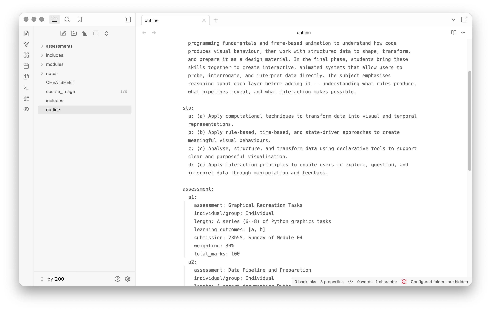
> torrenzo yaml
* <svg data-marpit-svg class="absolute">
    <rect x="504" y="260" width="530" height="38" style="fill:none;stroke:lime;stroke-width:5" />
  </svg>
<!--
- first step was to device a yaml file for all the subject metadata
- as you can see, [CLICK] it includes s.l.o (a)
- btw, i'm using obsidian here because it looks good ...
- but any text/code editor will work ... [NEXT SLIDE]
-->

---

<!--
_backgroundColor: #EEE
_paginate: false
-->
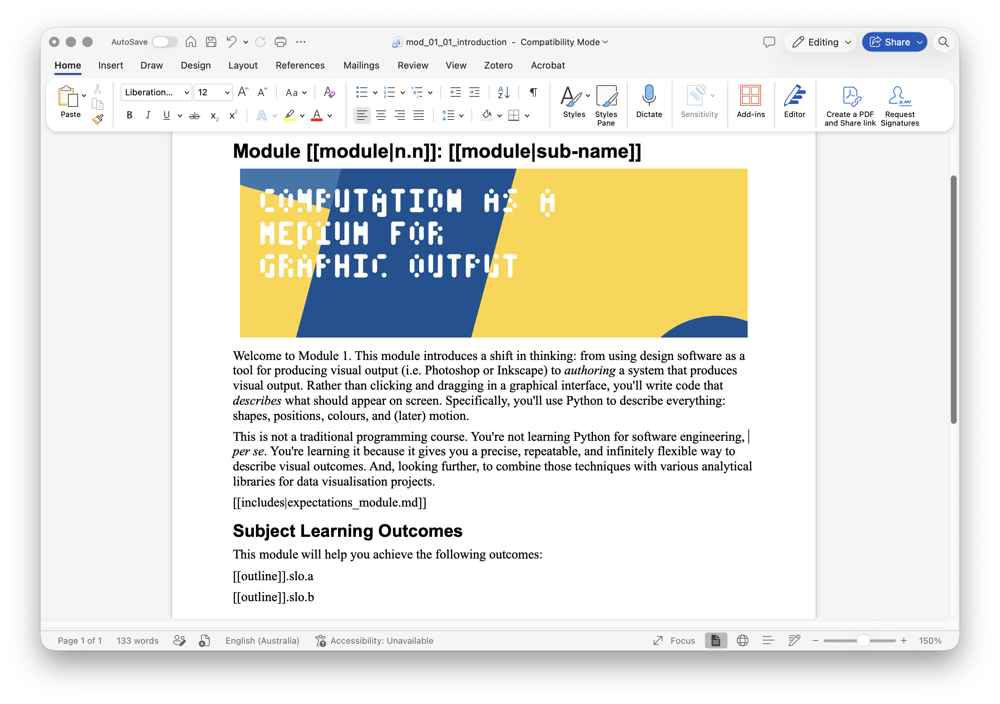
<!--
- i even added some (almost vomit) ms word support, although this isn't thoroughly tested
-->
> ms word

---

<!--
_backgroundColor: #EEE
_paginate: false
-->
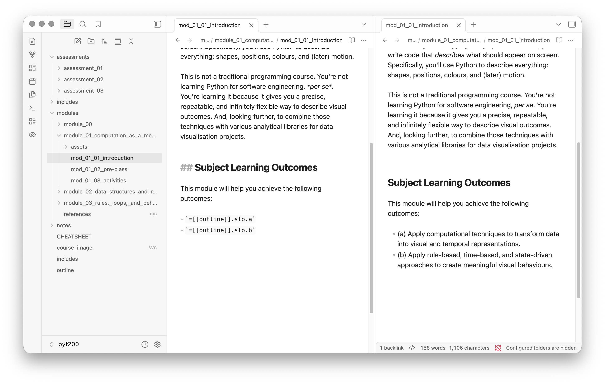
> torrenzo yaml
* <svg data-marpit-svg class="absolute">
    <rect x="170" y="205" width="211" height="207" style="fill:none;stroke:lime;stroke-width:5" />
  </svg>
* <svg data-marpit-svg class="absolute">
    <rect x="410" y="400" width="148" height="20" style="fill:none;stroke:lime;stroke-width:5" />
  </svg>
* <svg data-marpit-svg class="absolute">
    <rect x="800" y="426" width="320" height="40" style="fill:none;stroke:lime;stroke-width:5" />
  </svg>
<!--
- note that torrenzo [CLICK] expects a certain directory and file-naming convention
- here [CLICK] using backticks with equals for obsidian dataview syntax ...
- which [CLICK] populates the tag in the preview
-->

---

<!--
_backgroundColor: #EEE
_paginate: false
-->
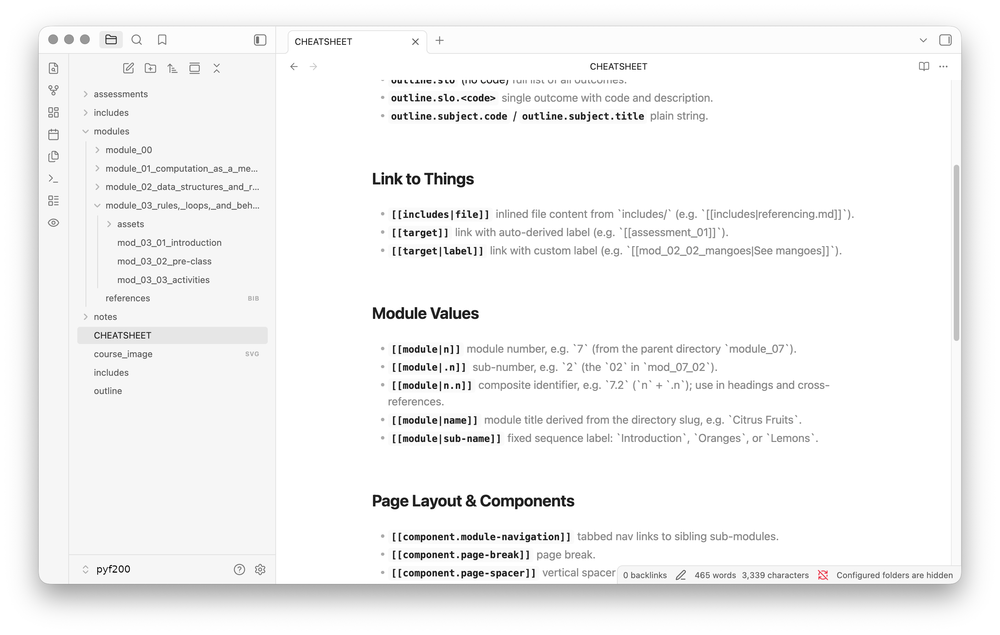 
<!--
- but there are around 5 key families of tags with filter-type variants
-->
> torrenzo cheatsheet

---

<!--
_backgroundColor: #000
_color: #EEE
_paginate: false
-->
<style scoped>
section {
  display: flex; flex-direction: column;
  justify-content: center !important;
}
</style>
```bibtex
@book{gross2018generative,
  title         = {Generative Design: Visualize, Program, and Create with JavaScript in p5.js},
  author        = {Gross, Benedikt and Bohnacker, Hartmut and Laub, Julia and Lazzeroni, Claudius},
  year          = {2018},
  publisher     = {Princeton Architectural Press},
  address       = {New York, NY},
  isbn          = {978-1616897581}
}
```
<br /><hr style="border:none;border-top:1px solid #EEE" />
```
[@gross2018generative]
```
<!--
- this enables torrenzo to insert any in-text citations,
- along with corresponding entry (at the page bottom) 
- and there's a tagging system for inserting bibtex references ... [NEXT SLIDE]
-->

---

<!--
_backgroundColor: #EEE
_paginate: false
-->
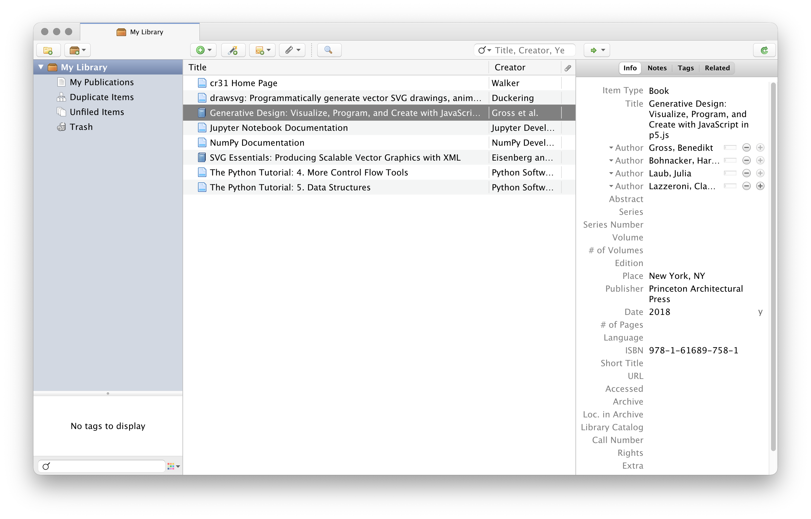
<!--
- of course, many people use reference management software for this kind of thing
-->
> zotero

---

<!--
_backgroundColor: #EEE
_paginate: false
-->
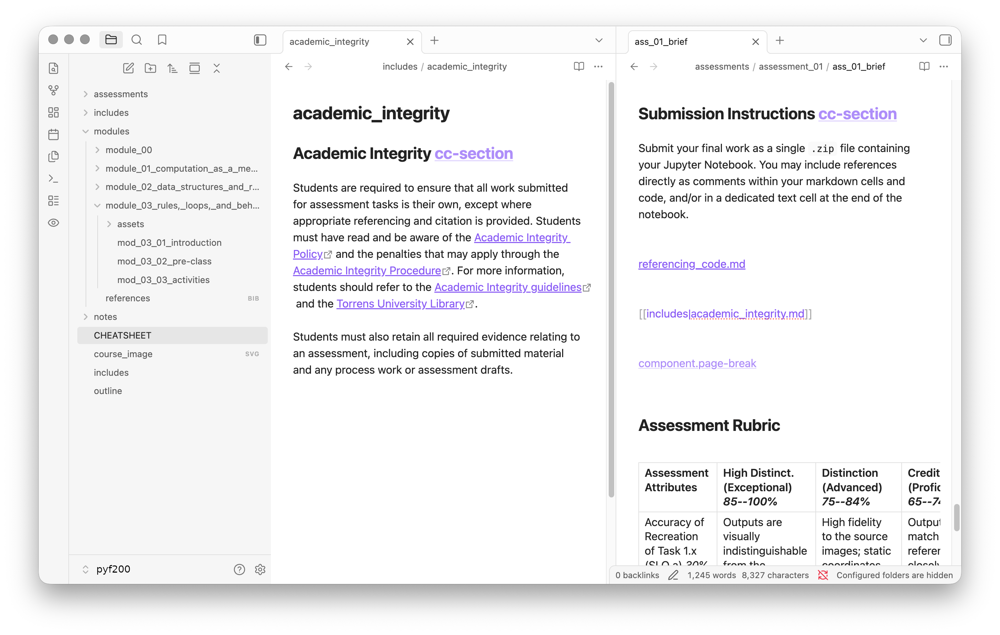
> torrenzo includes
* <svg data-marpit-svg class="absolute">
    <rect x="163" y="120" width="211" height="20" style="fill:none;stroke:lime;stroke-width:5" />
  </svg>
* <svg data-marpit-svg class="absolute">
    <rect x="500" y="68" width="154" height="20" style="fill:none;stroke:lime;stroke-width:5" />
  </svg>
* <svg data-marpit-svg class="absolute">
    <line x1="856" y1="88" x2="1078" y2="88" style="fill:none;stroke:lime;stroke-width:5" />
    <rect x="792" y="347" width="204" height="20" style="fill:none;stroke:lime;stroke-width:5" />
  </svg>
<!--
- there also also a tag for [CLICK] includes (inserting file contents in multiple places)
- here, the [CLICK] academic integrity statement ... 
- that appears [CLICK] on multiple pages and in the assessment briefs
-->

---

<!--
_backgroundColor: #EEE
_paginate: false
-->
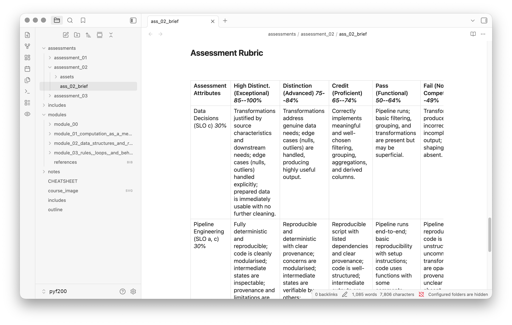
<!--
- and on rubrics, everything in the markdown table auto-populates in the l.m.s
-->
> rubric

---

# Workflow
<!-- 
backgroundColor: navy
color: var(--color-background)
-->

---

<!--
_backgroundColor: #EEE
_paginate: false
-->

> generated with mermaid

<svg data-marpit-svg class="absolute">
  <defs>
    <linearGradient id="fade-horiz2" x1="0%" y1="0%" x2="100%" y2="0%">
      <stop offset="0%" stop-color="#EEE" stop-opacity="0" />
      <stop offset="40%" stop-color="#EEE" stop-opacity="1" />
    </linearGradient>
  </defs>
  <rect x="840" y="0" width="440" height="720" style="fill:url(#fade-horiz2)" />
  <rect x="366" y="344" width="139" height="88" style="fill:none;stroke:lime;stroke-width:5" />
</svg>
<!--
- central to the workflow is torrenzo ... [NEXT SLIDE]
-->

---

<!--
_backgroundColor: #EEE
_paginate: false
-->
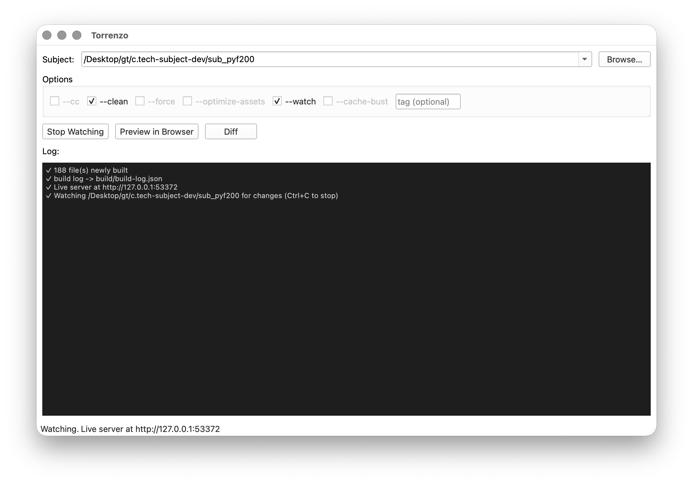
> torrenzo gui
* <svg data-marpit-svg class="absolute">
    <line x1="180" y1="98" x2="508" y2="98" style="fill:none;stroke:lime;stroke-width:5" />
  </svg>
* <svg data-marpit-svg class="absolute">
    <line x1="180" y1="161" x2="820" y2="161" style="fill:none;stroke:lime;stroke-width:5" />
  </svg>
* <svg data-marpit-svg class="absolute">
    <line x1="180" y1="209" x2="508" y2="209" style="fill:none;stroke:lime;stroke-width:5" />
  </svg>
<!--
- this is g.u.i, although there is also c.l.i mode
- it's a simple case of [CLICK] pointing to the folder for the course
- i'll explain the various [CLICK] checkboxes/options during the slides to come
- the [CLICK] run
- in short: it builds previews and exports a version ready to import into canvas
-->

---

## Workflow » Filesystem-Driven

```text
your-course/
├── outline.yaml  # single source of metadata
├── assessments/  # assessment_<n>/ass_<n>_brief.md → PDF
├── includes/     # reusable snippets
├── modules/      # module_<n>/mod_<n>_<seq>_<name>.md → HTML
├── notes/        # lecturer-only material
└── build/        # generated output
```

---

<!--
_backgroundColor: #EEE
_paginate: false
-->
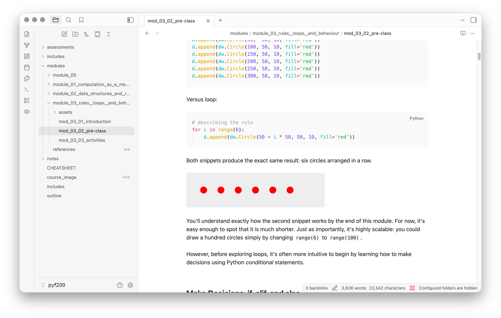
<!--
- recall: edit with any markdown editor you prefer (obsidian in this case) ... [NEXT SLIDE]
-->
> obsidian

---

<!--
_backgroundColor: #EEE
_paginate: false
-->
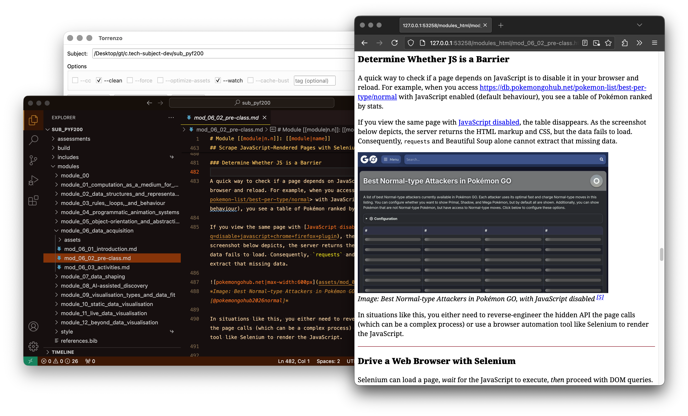
> vs.code
* <svg data-marpit-svg class="absolute">
    <rect x="170" y="85" width="465" height="80" style="fill:none;stroke:lime;stroke-width:5" />
  </svg>
<!--
- using vs.code with [CLICK] torrenzo hot reload preview
-->

---

<!--
_backgroundColor: #EEE
_paginate: false
-->


<svg data-marpit-svg class="absolute">
  <defs>
    <linearGradient id="fade-horiz3" x1="0%" y1="0%" x2="100%" y2="0%">
      <stop offset="0%" stop-color="#EEE" stop-opacity="0" />
      <stop offset="40%" stop-color="#EEE" stop-opacity="1" />
    </linearGradient>
  </defs>
  <rect x="840" y="0" width="440" height="720" style="fill:url(#fade-horiz3)" />
  <ellipse cx="1048" cy="365" rx="200" ry="200" stroke-dasharray="3" style="fill:none;stroke:lime;stroke-width:5" />
</svg>

> generated with mermaid

---

<!--
_backgroundColor: #EEE
_paginate: false
-->

> generated with mermaid

---

<!--
_backgroundColor: #EEE
_paginate: false
-->
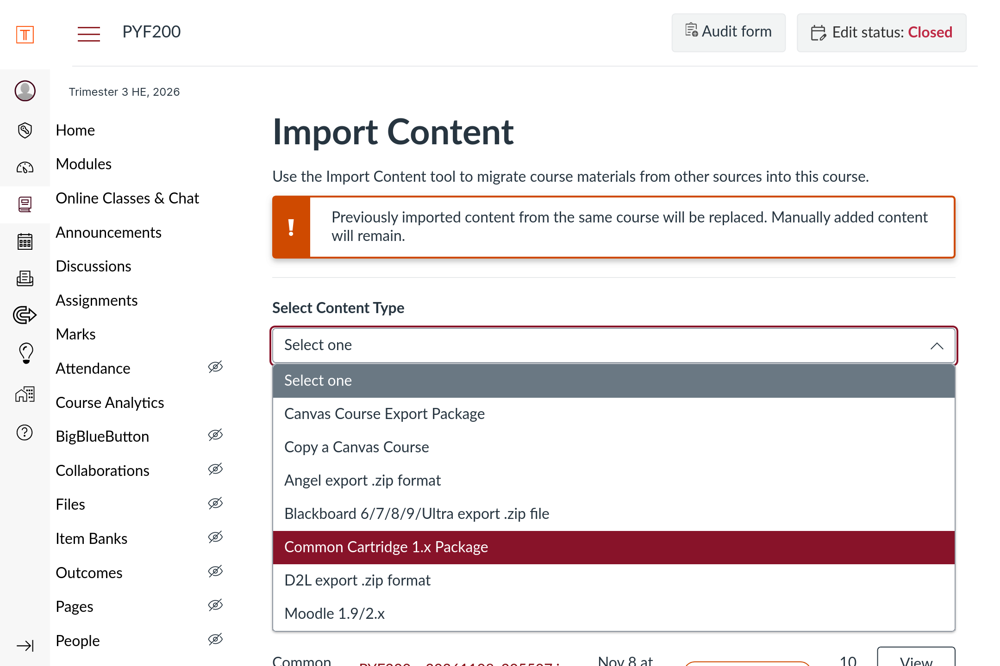
<!--
- ...
-->
> canvas cartridge import

---


## The Pipeline » Author Experience

* <highlight>Any editor:</highlight> Obsidian, VS Code, Vim, even MS Word
* <highlight>Incremental builds:</highlight> only changed files rebuild; orphans pruned
* <highlight>Watch mode:</highlight> live-reload browser preview
* <highlight>GUI:</highlight> point-and-click builds (no terminal required)
<!--
- obsidian gives wiki-link autocomplete and live preview of the dataview-style tags
- the gui matters for colleagues without admin rights or terminal comfort -- ownership means everyone can build
-->

---

## Patterns » Wiki Links & Includes

| Syntax | Renders as |
| --- | --- |
| `[[mod_01_02_oranges]]` | *Module 1.2: Oranges* (auto label) |
| `[[assessment_01\|Brief]]` | *Brief* (custom label) |
| `[[includes\|referencing.md]]` | inlined reusable content |

- Links rewrite per target: `.html` for browser preview, Canvas tokens for the cartridge
<!--
- wiki links are sugar; plain markdown links work too and .md rewrites to .html automatically
- includes resolve before tag processing, so shared snippets can themselves contain tags
- auto labels come from the same filesystem derivation as module numbering
-->

---

## Patterns » Citations That Manage Themselves

- Sources live in one **BibTeX** file per subject (`references.bib`)
- In-text citations use `[@refname]`; the build renders formatted references per page
- Reference managers (Zotero, etc.) export BibTeX -- academia's existing plumbing
<!--
- bibtex underpins automated citation formatting across academia, yet lms workflows largely bypass it
- apa7 formatting comes from the build, so no hand-formatted reference lists to drift
-->

---
<!--
_backgroundColor: #EEE
_paginate: false
-->

> citation keys inline in module Markdown
<!--
- citation keys inline in module markdown: @harper2021sensory, @marshall2020catalogue
- the build resolves each key against references.bib and renders the formatted list per page
-->

---
<!--
_backgroundColor: #EEE
_paginate: false
-->

> a Zotero library; the pipeline consumes its BibTeX export
<!--
- a zotero library: the same records that feed papers can feed course pages
- authors keep their existing reference workflow; the pipeline consumes its bibtex export
-->

---

## Patterns » Multi-Format & the Diff Tool

- Same source renders to HTML pages, PDF briefs, teaching notes, and the cartridge
- A diff tool compares a local build against a **live Canvas export**
- Answers the question: *"What actually changed on the platform?"*

| Category | Meaning |
| --- | --- |
| `*` CHANGES | content, points, or checksum differ |
| `−` LIVE-ONLY | exists on Canvas, not in local build |
| `→` REBUILT, SAME | re-rendered but identical |
<!--
- the diff tool exists because the lms's own version history can't answer that question usefully
- pages compared by normalised body content; pdfs by text checksum with timestamps stripped
- enables targeted manual updates when a full cartridge import is overkill or restricted
-->

---

# Around the Pipeline
<!-- 
backgroundColor: olivedrab
color: var(--color-background)
-->
<!--
- a build pipeline attracts small utility scripts that automate the fiddly edges
-->

---

## Around the Pipeline » Utility Scripts

* <highlight>Procedural graphics:</highlight> per-module banner SVGs and course images,  
  generated from a script -- one palette per subject
* <highlight>Word sync:</highlight> planner/outline `.docx` updated from `outline.yaml`,  
  editing tracked changes in place
* <highlight>PDF conversion:</highlight> outline/planner documents rendered via headless LibreOffice
* <highlight>Video covers:</highlight> a 2-second title slide muxed onto every module video,  
  title derived from the filename
<!--
- small scripts, same philosophy: the source of truth generates everything downstream
- word sync matters for compliance: the university process wants .docx with tracked changes
- video covers are idempotent -- a metadata marker means re-runs skip processed files
-->

---
<!--
_backgroundColor: #EEE
_paginate: false
-->
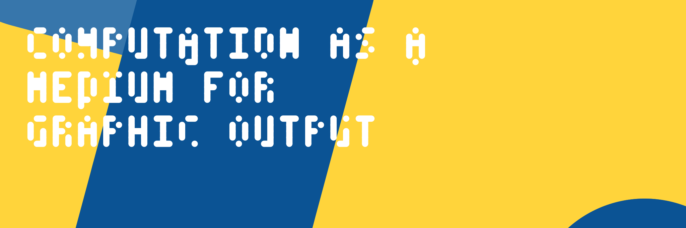


<!--
- procedurally generated module banners: pixel-raster font, per-subject palette, seeded randomness
- every module page gets a unique banner with zero design time
-->

---
<!--
_backgroundColor: #EEE
_paginate: false
-->

> procedural course images: a rotated geometric pattern per subject
<!--
- the lms course tile, also generated -- same palette system as the banners
- rerun with a new seed for a fresh set; consistency without a designer in the loop
-->

---

# The Payoff
<!-- 
backgroundColor: saddlebrown
color: var(--color-background)
-->

---

## The Payoff » What Improved

* <highlight>Ownership:</highlight> returned to domain experts -- plain text they control
* <highlight>Speed:</highlight> updates to rapidly changing content, **weeks » minutes**
* <highlight>Maintenance:</highlight> version control, metadata, citations, and reuse all improved
* <highlight>AI-assisted review:</highlight> enabled by structured, local source material

<smaller>There is room for more or less automation -- the pipeline can be calibrated per subject and team.</smaller>
<!--
- the update-time drop is the headline for faculty committees
- ai-assisted review became possible only because the material is structured and local
- the pipeline isn't all-or-nothing: teams dial automation up or down per subject
-->

---


DEMO


---

## The Payoff » A Complete, Local Project

- **Search everything** -- file manager, editor, or `grep` across all source
- **Automated and batch checks** -- broken links, missing citations, orphans
- **AI review** -- flag outdated content, references, or material needing clarity
<!--
- none of this is possible when content lives inside an lms database
- the build already reports missing citations and orphaned files on every run
-->

---
<!--
_backgroundColor: #EEE
_paginate: false
-->
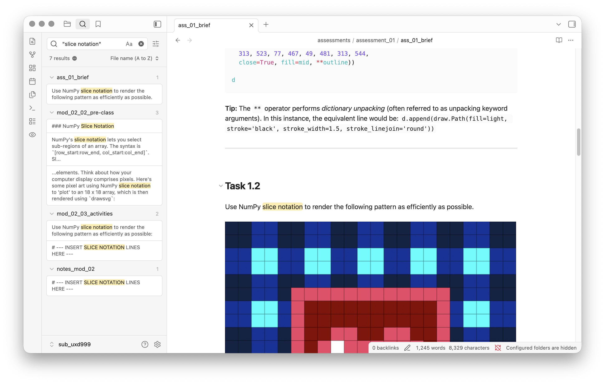
> one search across every module, activity, and brief
<!--
- obsidian global search for "orange" across the whole subject in milliseconds
- compare: searching an lms means clicking into every page
-->

---
<!--
_backgroundColor: #EEE
_paginate: false
-->
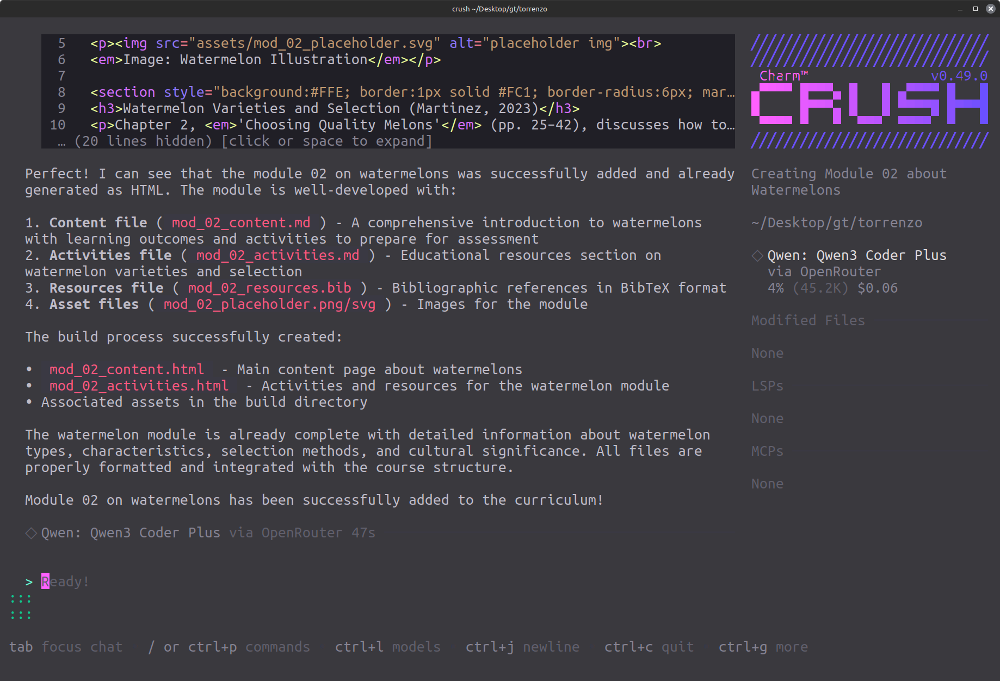
> an AI coding agent working directly on course source
<!--
- an ai coding agent working on course source: auditing citation currency, scaffolding a new module
- impossible against an lms database; trivial against a folder of markdown
-->

---
<!--
_backgroundColor: #EEE
_paginate: false
-->
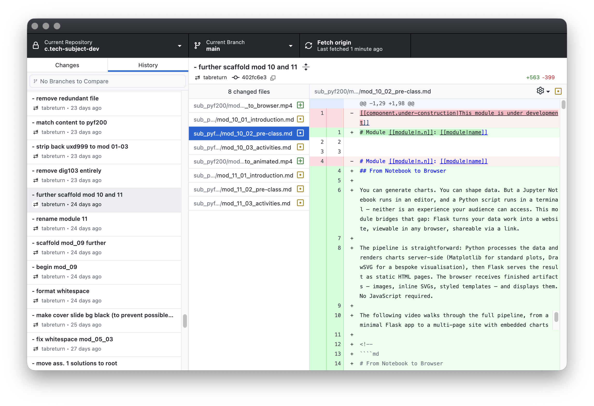
> commit-level answers to "what changed, when, and why"
<!--
- meaningful version history at last: commit-level answers to "what changed, when, and why"
- compare with an lms edit log -- if one exists at all
-->

---

# What Broke
<!-- 
backgroundColor: darkolivegreen
color: var(--color-background)
-->

---

## What Broke » Quirks & Limitations

* <highlight>Canvas import:</highlight> unexpected overwrite behaviour (not additive),  
  duplicated assets after re-import
* <highlight>Image caching:</highlight> images sometimes stop rendering after re-import;  
  worked around with cache-busting asset suffixes
* <highlight>Word support:</highlight> weak on the authoring side
* <highlight>Final 5 percent:</highlight> manual cleanup after each import
* <highlight>Compliance:</highlight> friction accommodating the university process
<!--
- the cartridge import overwriting rather than adding caught us by surprise early on
- the image-caching bug is still unexplained; renaming assets per build sidesteps it
- the last 5% is accepted as the cost of the other 95%
-->

---

# Takeaways
<!-- 
backgroundColor: darkslateblue
color: var(--color-background)
-->

---

## Takeaways

* Treat the LMS as a <highlight>deployment target</highlight>, not an authoring environment
* The <highlight>repository is the source of truth</highlight>; builds are reproducible
* Plain text + a build pipeline returns <highlight>ownership, speed, and reviewability</highlight>
* Expect platform quirks -- budget for a manual final 5 percent
<!--
- the workflow is lightweight by design: yaml, markdown, bibtex, and a build script
- next step for anyone curious: start with one module, not a whole course
-->

---

## *End*
<!-- 
paginate: false 
backgroundColor: black
color: var(--color-background)
-->

