---

marp: true
theme: tabreturn
notes: ...

---

# ***The LMS as a Build Target***
<!--
_backgroundColor: black
_backgroundImage: "url(title_bg.png)"
_backgroundSize: "cover"
color: var(--color-background)
-->
<!--
- shifting the source of truth for course content out of the LMS and into a publishing pipeline
-->

---

# Introductions
<!-- 
paginate: true
backgroundColor: darkslategrey
-->

---

## Introductions » Myself
* Interactive media lecturer
* Designer → developer → creative/design technologist
* Industry experience in startups, multimedia studios, web departments

---

<!--
_backgroundColor: black
_paginate: false
-->
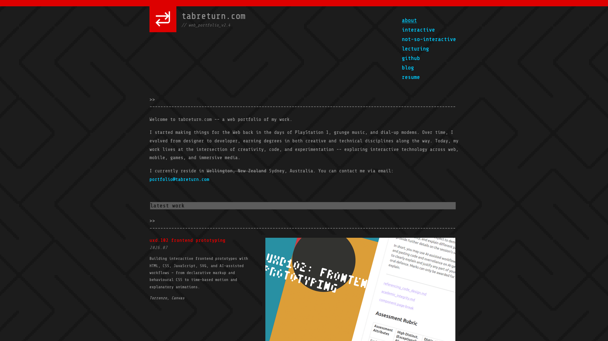
> tabreturn.com
<!--
- if you'd like to view more of my work, check out my portfolio website
-->

---

## Introductions » You?
* Who has worked with an LMS (Learning Management System)?
* Blackboard, Canvas, D2L, Moodle, ... ?
* 360Learning, Absorb, Docebo, TalentLMS, ... ?
* Learning designers or educators?
* <svg data-marpit-svg class="absolute">
    <rect x="300" y="235" width="124" height="49" style="fill:none;stroke:lime;stroke-width:5" />
  </svg>
<!--
- note that i'm familiar with solutions popular in secondary/tertiary education
- this talk specifically concerns [CLICK] canvas ... [NEXT 2 SLIDES]
-->

---

<!--
_backgroundColor: #EEE
_paginate: false
-->
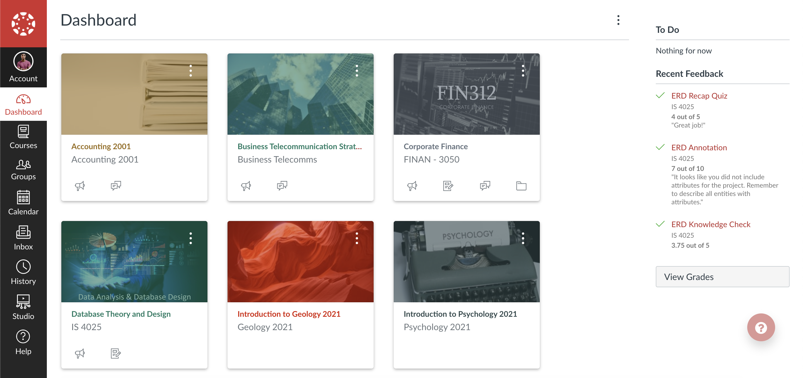
> canvas lms
<!--
- canvas provides students a single, unified hub across every course/subject they take
- built-in cms for editing materials; as well as grading features, analytics, and more
- you may have heard of it from the 2026 canvas data breach ...
- over 8,000 educational institutions
- (inc. many notable australian unis, princeton, harvard, ...)
-->

---

<!--
_backgroundColor: #EEE
_paginate: false
-->

> canvas lms
* <svg data-marpit-svg class="absolute">
    <rect x="112" y="140" width="165" height="235" style="fill:none;stroke:lime;stroke-width:5" />
  </svg>
* <svg data-marpit-svg class="absolute">
    <rect x="1011" y="140" width="231" height="478" style="fill:none;stroke:lime;stroke-width:5" />
  </svg>
<!--
- typical subject page
- note [CLICK] left column for main navigation, and right column [CLICK] listing assessment deadlines
-->

---

<!--
_backgroundColor: #EEE
_paginate: false
-->
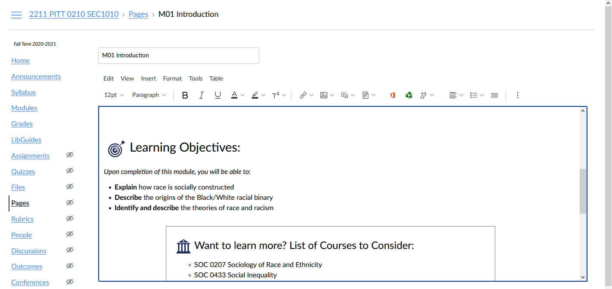
> canvas lms
<!--
- as far as editing goes, it's your standard wysiwyg / rich-text editor affair
- note that editing is a per-page exercise
-->

---


# The Problem(s)
<!-- 
paginate: true
backgroundColor: maroon
-->
<!--
- i started to look at reworking subjects --
- i'll discuss issues obvious at first glance shortly, but --
- i reached the ultimate conclusion that ... [NEXT SLIDE]
-->

---

## The Problem(s) » Talk Premise
### *The (Canvas) LMS is a good place to <highlight>deliver</highlight> a subject, <br />but a poor place to <highlight>author</highlight> one.*
<!--
- have to caveat that with ... [NEXT SLIDE]
-->

---

## The Problem(s) » Talk Premise
### *The (Canvas) LMS is a good place to <highlight>deliver</highlight> a subject, <br />but a poor place to <highlight>author</highlight> one.*
<p>&nbsp;</p>
<smaller>⚠️<br />At least, this seemed obvious to somebody with some experience working on digital products, popular project documentation systems, LaTeX, static-site-generators, etc.</smaller>
<!--
- and another caveat ... [NEXT SLIDE]
-->

---

## The Problem(s) » Talk Premise
### *The (Canvas) LMS is a good place to <highlight>deliver</highlight> a subject, <br />but a poor place to <highlight>author</highlight> one.*
<p>&nbsp;</p>
<smaller>⚠️<br />At least, this seemed obvious to somebody with some experience working on digital products, popular project documentation systems, LaTeX, static-site-generators, etc.</smaller>
<br /><br />
<smaller>⚠️<br />Third-party Canvas plugins (LTIs) likely address some of my gripes, but require institutional licensing (see money) and IT sign-off, which is prohibitive.</smaller>

---

## The Problem(s) » Immediate Concerns ...

* <highlight>`1.` Content Drift</highlight>  
  No imports, variables, or shared blocks to stay in sync
* <highlight>`2.` Siloed Pages</highlight>  
  'Keyhole' editing, no narrative view, massive click-tax
* <highlight>`3.` Form Torture</highlight>  
  Example: clicking tiny boxes and dropdowns to build rubrics
<!--
- keyhole editing: u.x metaphor borrowed from joke about painting a hallway through the letterbox/keyhole
-->

---

## The Problem(s) » Immediate Concerns ...
- <highlight>`1.` Content Drift</highlight>  
  No imports, variables, or shared blocks to stay in sync
- <highlight>`2.` Siloed Pages</highlight>  
  'Keyhole' editing, no narrative view, massive click-tax
- <highlight>`3.` Form Torture</highlight>  
  Example: clicking tiny boxes and dropdowns to build rubrics

<p>&nbsp;</p>
<smaller>Furthermore: browser-bound workflow, hostile to AI/CLI work, link rot, shallow version history, general lack of automation ... And, the LMS ends up the de facto source of truth <i>-- but not really.</i></smaller>
<!--
- browser-bound: slow reloads, constant tab-juggling, zero offline work
- hostile to a.i/c.l.i: database silos block local editors, scripts, and agents
- link rot: swapping files breaks links or serves stale cached copies
- source of truth but not really: pdf source documents really on ms word
- but, let me run through some examples ... [NEXT SLIDE]
-->

---

# 1. Content Drift
<!-- 
paginate: true
backgroundColor: rebeccapurple
-->
<!--
- recall: no imports, variables, or shared blocks to stay in sync
-->

---

<!--
_backgroundColor: #EEE
_paginate: false
-->
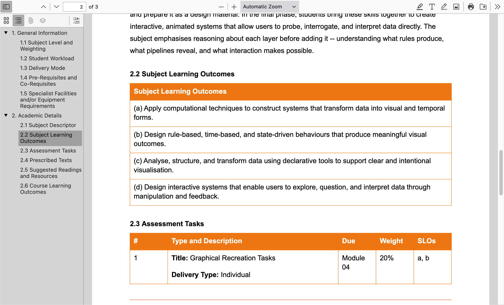
> pyf200 subject
* <svg data-marpit-svg class="absolute">
    <rect x="405" y="260" width="622" height="51" style="fill:none;stroke:lime;stroke-width:5" />
  </svg>
* <svg data-marpit-svg class="absolute">
    <rect x="952" y="550" width="74" height="65" style="fill:none;stroke:lime;stroke-width:5" />
  </svg>
<!--
- anybody familiar with these kind of documents? explain ...
- subject learning outcomes necessary for "constructive alignment" and "curriculum mapping", etc.
- for example let us focus on s.l.o (a) [CLICK]
- every single assessment brief [CLICK], grading rubric, module, etc. maps to these ... [NEXT SLIDE]
-->

---

<!--
_backgroundColor: #EEE
_paginate: false
-->
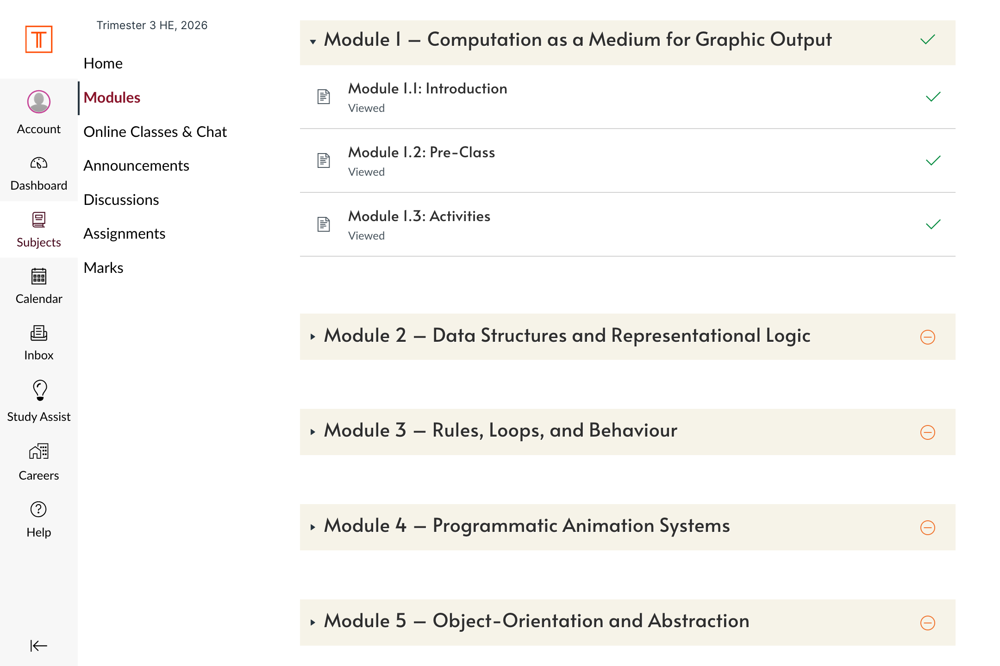
> pyf200 subject
* <svg data-marpit-svg class="absolute">
    <ellipse cx="620" cy="147" rx="20" ry="20" stroke-dasharray="3" style="fill:none;stroke:lime;stroke-width:5" />
  </svg>
<!--
- here's the thing -- there are usually 12 modules ...
- and each intro sub-module lists its s.l.o mappings
- lets [CLICK] navigate the first ... [NEXT SLIDE]
-->

---

<!--
_backgroundColor: #EEE
_paginate: false
-->
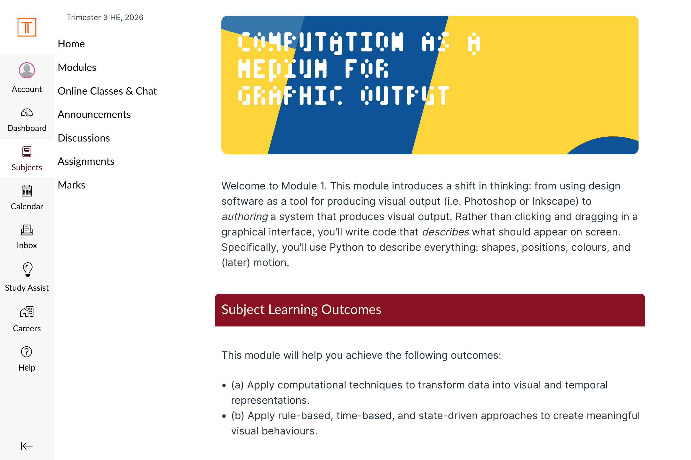
> pyf200 subject
* <svg data-marpit-svg class="absolute">
    <rect x="470" y="546" width="560" height="46" style="fill:none;stroke:lime;stroke-width:5" />
  </svg>
<!--
- note [CLICK] our friend s.l.o (a) mapped as a module outcome
- note it doesn't list all four --
- different slo items map to different modules
-->

---

<!--
_backgroundColor: #EEE
_paginate: false
-->
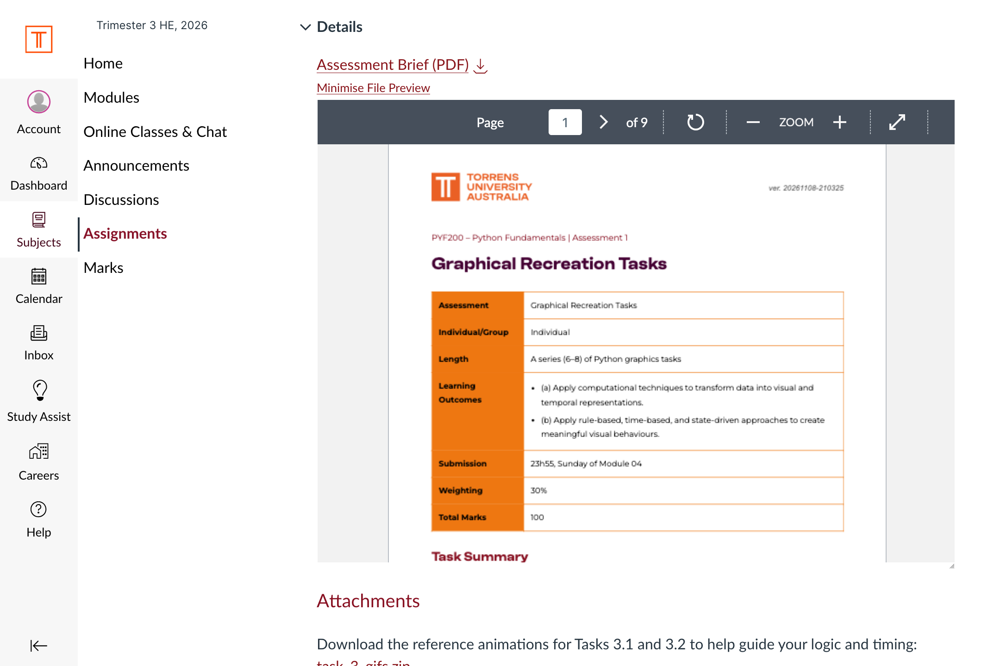
> pyf200 subject
* <svg data-marpit-svg class="absolute">
    <rect x="660" y="397" width="288" height="33" style="fill:none;stroke:lime;stroke-width:5" />
  </svg>
<!--
- what's more: there are different s.l.o mappings for different assessment briefs
- which are (as you might have guessed from the screenshot) embedded pdf documents
-->

---

## 1. Content Drift » Scenario
### *Somebody needs a change to SLO (a) --*
* Make official change to the learning outline
* Update (potentially) 12 module Intro instances ...
* And to find these, you'll need to click through every module
* Then, update (potentially) 3 assessment briefs ...
* But those brief source files are MS Word documents ...
* That then require re-exporting as PDF, and uploading ...
* Only for caching to display the old version.
<!--
- of course, you can rename the pdf, but what other links does that break? (see link rot)
-->

---

# 2. Siloed Pages
<!-- 
paginate: true
backgroundColor: darkgreen
-->
<!--
- recall: keyhole editing, no narrative view, massive click-tax ...
- this also affects styling! ... [NEXT SLIDE]
-->

---

<!--
_backgroundColor: #EEE
_paginate: false
-->
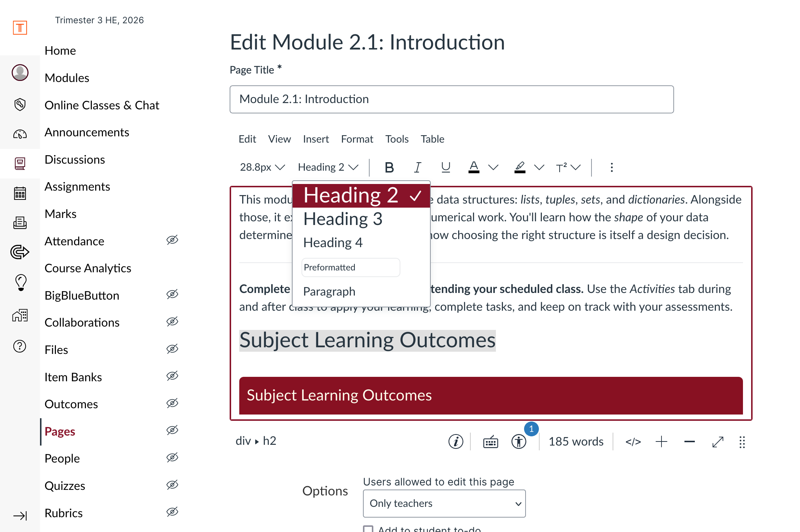
<!--
- the default headings require further styling ...
- admittedly, the global stylesheet thing is on us
- in defense, this content has been migrated from another l.m.s, changing template designs, etc.
- but, there are always bespoke elements that require uniform styling ... [NEXT SLIDE]
-->
> pyf200 subject

---

<!--
_backgroundColor: #EEE
_paginate: false
-->
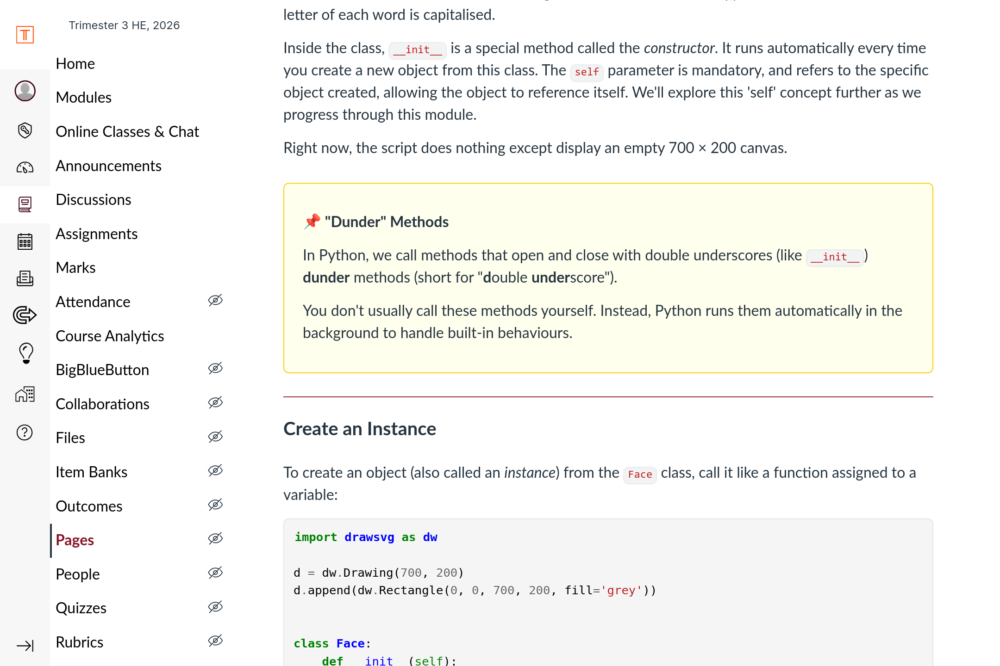
<!--
- like these callout notes, for example
- let's consider 2 scenarios ... [NEXT SLIDE]
-->
> pyf200 subject

---

## 2. Siloed Pages » Scenario 1
### *All callout boxes require a different background colour --*
* Open a page and visually scan for these elements ...
* (alternatively, open the WYSIWYG HTML view and search the source)
* Then apply new styling manually
* Open the next page and repeat (potentially 12 × 3 times).

---

## 2. Siloed Pages » Scenario 2
### *All instances of the term "Twitter" need replacing --*
* Open a page and search for "Twitter" and replace with "X" ...
* Open the next page and repeat (potentially 12 × 3 times)
* Then, update (potentially) 3 assessment briefs ...
* But those briefs are MS Word documents ...
* That then require re-exporting as PDF, and uploading.
<!--
- and on last point: don't forget caching challenges
-->

---

# 3. Form Torture
<!-- 
paginate: true
backgroundColor: indigo
color: var(--color-background)
-->
<!--
- recall: clicking many tiny boxes and dropdowns
-->

---

<!--
_backgroundColor: #EEE
_paginate: false
-->
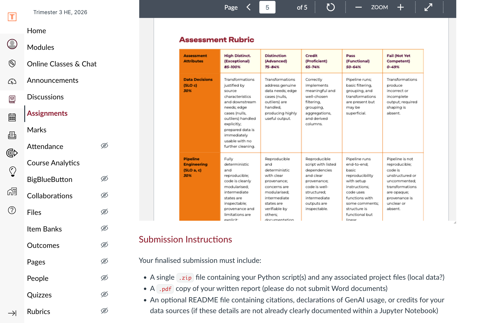
> pyf200 assessment pdf
<!---
- recall that assessment briefs are embedded pdf files
- each assessment includes a grading rubric ... [NEXT]
-->

---

<!--
_backgroundColor: #EEE
_paginate: false
-->
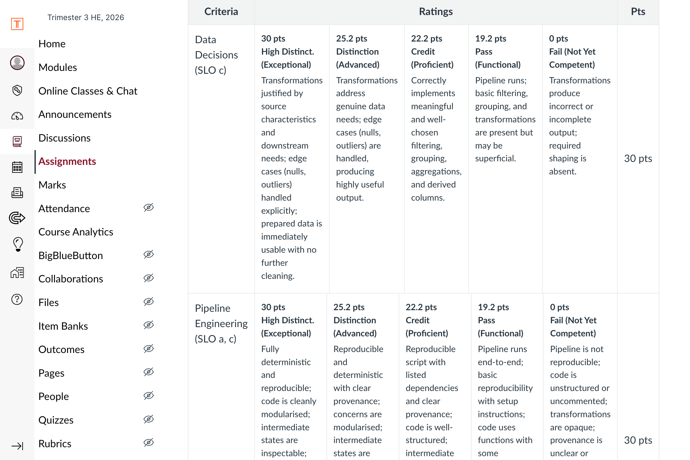
> canvas rubric
<!---
- but the grading system is part of the l.m.s configuration, and ...
- dealing with l.m.s grading rubrics is a fiddly affair
- critical: you cannot edit them after the submission date --
- need to be accurate and consistent!
-->

---

## 3. Form Torture » Scenario
### *Assessment 1 rubric requires an additional criterion --*
* Locate the relevant brief source document (MS Word)
* Make the change, then re-export as PDF and upload
* (Don't forget caching might bite you in the butt)
* Now manually edit the corresponding Canvas rubric (fiddly business).

---

# Solution
<!-- 
backgroundColor: darkcyan
color: var(--color-background)
-->
<!--
- with some introduction to *some* of the problems, let's look at the solution i devised
-->

---

## Solution » What If ...
<hr style="border:none;border-top:1px solid #EEE" />

<larger>***The LMS is just a build target?***</larger>

<hr style="border:none;border-top:1px solid #EEE" /><br />

* <highlight>Write content once</highlight> in structured source files
* <highlight>Automatically generate</highlight> LMS module pages, assessment briefs, ...
* Need a change? Edit those source materials, rebuild, re-upload.

---

## Solution » Mental Model

Same inversion documentarians use for modern docs portals --
* The (Git?) repository is the *source of truth*
* A build step *renders the outputs*
* The website is just the *deployment target*
<!--
- and of specific inspiration to me was ... [NEXT SLIDE]
-->

---

## Solution » SSG-Inspired Pipeline
<h3><highlight>Static Site Generators</highlight></h3>
<!--
- (in case anybody is not aware) ... [NEXT SLIDE]
-->

---

## Solution » SSG-Inspired Pipeline
<h3><highlight>Static Site Generators</highlight></h3>

*Compiles a structured folder of plain-text files -- following specific directory, naming, and metadata conventions -- into a clean, fast HTML website with no database or WYSIWYG required.*

<hr style="border:none;border-top:1px solid #EEE" />

* **General / Blogs**  
  *Hugo, Jekyll, Eleventy, ...*
* **Docs / Guides**  
  *MkDocs, Docusaurus, VitePress, ...*
<!---
- fun fact: i fell hard for s.s.g back when github pages introduced jekyll
-->

---

<!--
_backgroundColor: #EEE
_paginate: false
-->
> generated with mermaid

<svg data-marpit-svg class="absolute">
  <defs>
    <linearGradient id="fade-horiz0" x1="0%" y1="0%" x2="100%" y2="0%">
      <stop offset="0%" stop-color="#EEE" stop-opacity="0" />
      <stop offset="40%" stop-color="#EEE" stop-opacity="1" />
    </linearGradient>
  </defs>
  <rect x="840" y="0" width="440" height="720" style="fill:url(#fade-horiz0)" />
</svg>

* <svg data-marpit-svg class="absolute">
    <rect x="18" y="80" width="330" height="560" style="fill:none;stroke:lime;stroke-width:5" />
  </svg>
* <svg data-marpit-svg class="absolute">
    <rect x="525" y="80" width="295" height="560" style="fill:none;stroke:lime;stroke-width:5" />
  </svg>
<!--
- torrenzo is the name of the software
-->

---

<!--
_backgroundColor: #EEE
_paginate: false
-->

> generated with mermaid

<svg data-marpit-svg class="absolute">
  <defs>
    <linearGradient id="fade-horiz1" x1="0%" y1="0%" x2="100%" y2="0%">
      <stop offset="0%" stop-color="#EEE" stop-opacity="0" />
      <stop offset="40%" stop-color="#EEE" stop-opacity="1" />
    </linearGradient>
  </defs>
  <rect x="840" y="0" width="440" height="720" style="fill:url(#fade-horiz1)" />
</svg>
<svg data-marpit-svg class="absolute">
  <rect x="58" y="128" width="247" height="97" rx="10px" style="fill:none;stroke:red;stroke-width:5" />
</svg>

---

<!--
_backgroundColor: #EEE
_paginate: false
-->
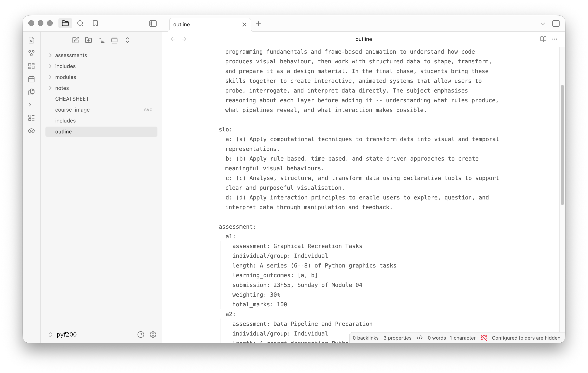
> torrenzo yaml
* <svg data-marpit-svg class="absolute">
    <rect x="504" y="260" width="530" height="38" style="fill:none;stroke:lime;stroke-width:5" />
  </svg>
<!--
- first step was to device a yaml file for all the subject metadata
- as you can see, [CLICK] it includes s.l.o (a)
- btw, i'm using obsidian here because it looks good ...
- but any text/code editor will work ... [NEXT SLIDE]
-->

---

<!--
_backgroundColor: #EEE
_paginate: false
-->

> generated with mermaid

<svg data-marpit-svg class="absolute">
  <defs>
    <linearGradient id="fade-horiz2" x1="0%" y1="0%" x2="100%" y2="0%">
      <stop offset="0%" stop-color="#EEE" stop-opacity="0" />
      <stop offset="40%" stop-color="#EEE" stop-opacity="1" />
    </linearGradient>
  </defs>
  <rect x="840" y="0" width="440" height="720" style="fill:url(#fade-horiz2)" />
</svg>
<svg data-marpit-svg class="absolute">
  <rect x="58" y="273" width="247" height="97" rx="10px" style="fill:none;stroke:red;stroke-width:5" />
</svg>

---

<!--
_backgroundColor: #EEE
_paginate: false
-->
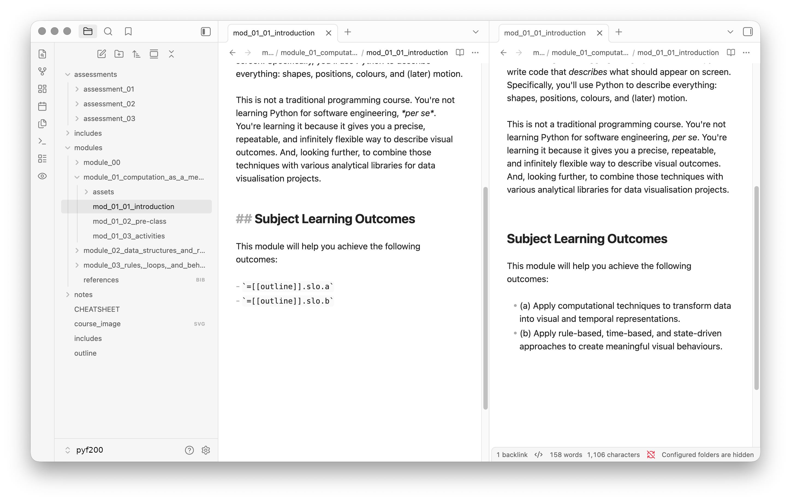
> torrenzo yaml
* <svg data-marpit-svg class="absolute">
    <rect x="170" y="205" width="211" height="207" style="fill:none;stroke:lime;stroke-width:5" />
  </svg>
* <svg data-marpit-svg class="absolute">
    <rect x="410" y="400" width="148" height="20" style="fill:none;stroke:lime;stroke-width:5" />
  </svg>
* <svg data-marpit-svg class="absolute">
    <rect x="800" y="426" width="320" height="40" style="fill:none;stroke:lime;stroke-width:5" />
  </svg>
<!--
- note that torrenzo [CLICK] expects a certain directory and file-naming convention
- here [CLICK] using backticks with equals for obsidian dataview syntax ...
- which [CLICK] populates the tag in the preview
-->

---

<!--
_backgroundColor: #EEE
_paginate: false
-->
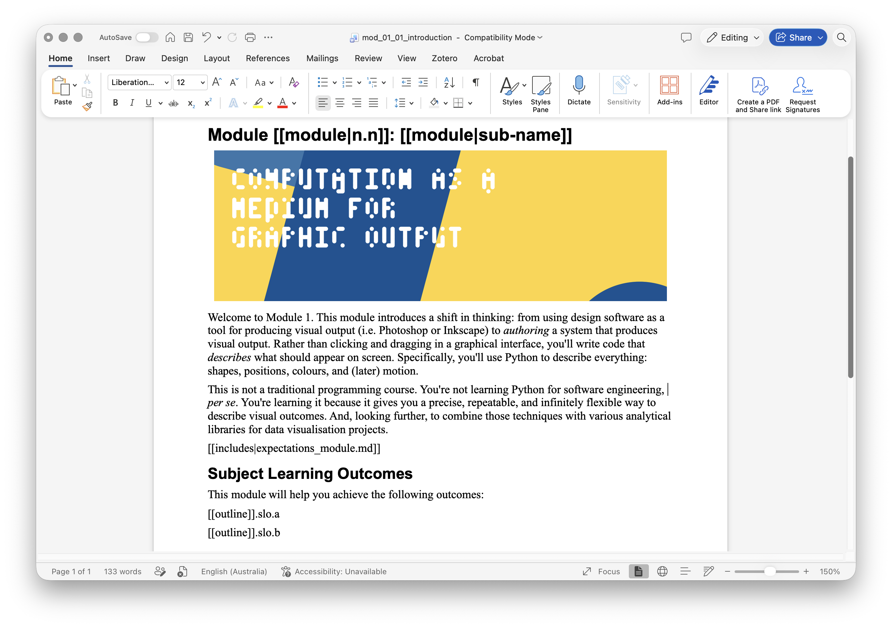
<!--
- i even added some (almost vomit) ms word support, although this isn't thoroughly tested
-->
> ms word

---

<!--
_backgroundColor: #EEE
_paginate: false
-->
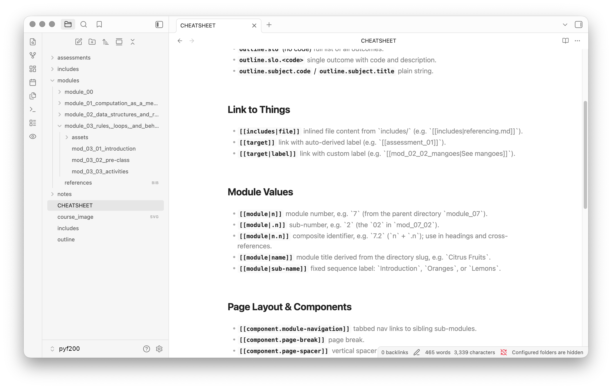 
<!--
- but there are around 5 key families of tags with filter-type variants
-->
> torrenzo cheatsheet

---

<!--
_backgroundColor: #000
_color: #EEE
_paginate: false
-->
<style scoped>
section {
  display: flex; flex-direction: column;
  justify-content: center !important;
}
</style>
```bibtex
@book{gross2018generative,
  title         = {Generative Design: Visualize, Program, and Create with JavaScript in p5.js},
  author        = {Gross, Benedikt and Bohnacker, Hartmut and Laub, Julia and Lazzeroni, Claudius},
  year          = {2018},
  publisher     = {Princeton Architectural Press},
  address       = {New York, NY},
  isbn          = {978-1616897581}
}
```
<br /><hr style="border:none;border-top:1px solid #EEE" />
```
[@gross2018generative]
```
<!--
- also includes tags for referencing --
- this enables torrenzo to insert any in-text citations,
- along with corresponding refernce list entry (at the page bottom, wikipedia style) 
- note this is bibtex ... [NEXT SLIDE]
-->

---

<!--
_backgroundColor: #EEE
_paginate: false
-->
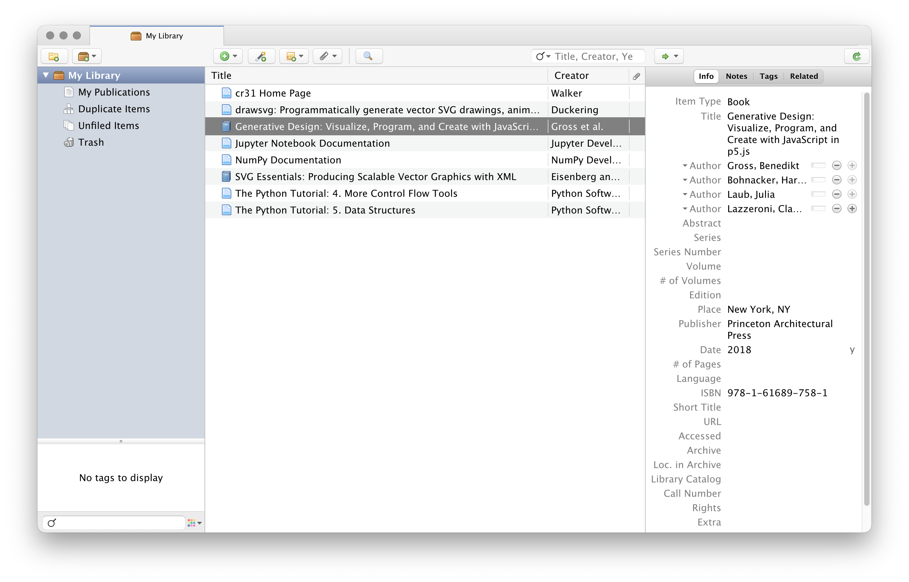
<!--
- meaning you can you any reference management software you like
- (this is zotero, but there are mendeley and others)
-->
> zotero

---

<!--
_backgroundColor: #EEE
_paginate: false
-->

> generated with mermaid

<svg data-marpit-svg class="absolute">
  <defs>
    <linearGradient id="fade-horiz3" x1="0%" y1="0%" x2="100%" y2="0%">
      <stop offset="0%" stop-color="#EEE" stop-opacity="0" />
      <stop offset="40%" stop-color="#EEE" stop-opacity="1" />
    </linearGradient>
  </defs>
  <rect x="840" y="0" width="440" height="720" style="fill:url(#fade-horiz3)" />
</svg>
<svg data-marpit-svg class="absolute">
  <rect x="75" y="418" width="214" height="73" rx="10px" style="fill:none;stroke:red;stroke-width:5" />
</svg>

---

<!--
_backgroundColor: #EEE
_paginate: false
-->
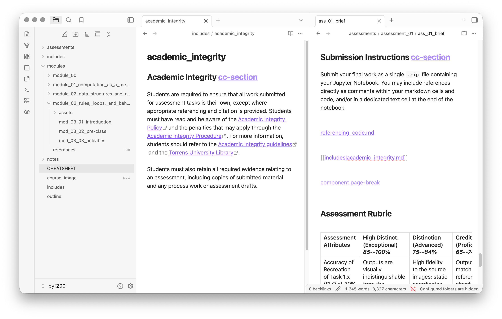
> torrenzo includes
* <svg data-marpit-svg class="absolute">
    <rect x="163" y="120" width="211" height="20" style="fill:none;stroke:lime;stroke-width:5" />
  </svg>
* <svg data-marpit-svg class="absolute">
    <rect x="500" y="68" width="154" height="20" style="fill:none;stroke:lime;stroke-width:5" />
  </svg>
* <svg data-marpit-svg class="absolute">
    <line x1="856" y1="88" x2="1078" y2="88" style="fill:none;stroke:lime;stroke-width:5" />
    <rect x="792" y="347" width="204" height="20" style="fill:none;stroke:lime;stroke-width:5" />
  </svg>
<!--
- recall that briefs used to be word docs, requiring pdf export (straddling source of truth)
- there also also a tag for [CLICK] includes (inserting file contents in multiple places)
- (this works in modules and briefs)
- here, the [CLICK] academic integrity statement ... 
- that appears [CLICK] in the assessment briefs (and on multiple pages)
-->

---

<!--
_backgroundColor: #EEE
_paginate: false
-->
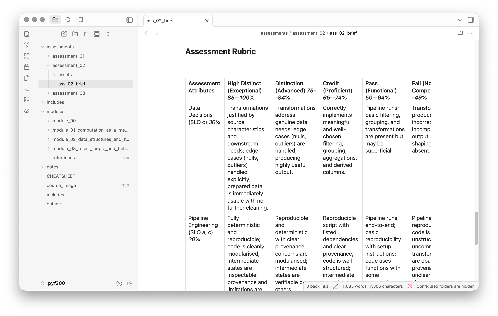
<!--
- and on rubrics, everything in the markdown table auto-populates in the l.m.s
-->
> rubric

---

# Torrenzo
<!-- 
backgroundColor: navy
color: var(--color-background)
-->
<!--
- now let's focus on what makes it all work: torrenzo [NEXT SLIDE]
-->

---

<!--
_backgroundColor: #EEE
_paginate: false
-->

> generated with mermaid

<svg data-marpit-svg class="absolute">
  <defs>
    <linearGradient id="fade-horiz4" x1="0%" y1="0%" x2="100%" y2="0%">
      <stop offset="0%" stop-color="#EEE" stop-opacity="0" />
      <stop offset="40%" stop-color="#EEE" stop-opacity="1" />
    </linearGradient>
  </defs>
  <rect x="840" y="0" width="440" height="720" style="fill:url(#fade-horiz4)" />
  <rect x="366" y="344" width="139" height="88" style="fill:none;stroke:lime;stroke-width:5" />
</svg>
<!--
- this has a g.u.i, although there is also c.l.i mode ... [NEXT SLIDE]
-->

---

<!--
_backgroundColor: #EEE
_paginate: false
-->
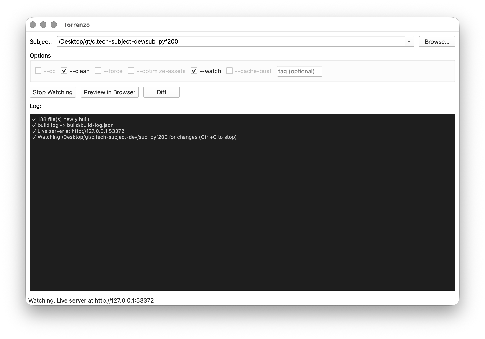
> torrenzo gui
* <svg data-marpit-svg class="absolute">
    <line x1="180" y1="98" x2="508" y2="98" style="fill:none;stroke:lime;stroke-width:5" />
  </svg>
* <svg data-marpit-svg class="absolute">
    <line x1="180" y1="161" x2="820" y2="161" style="fill:none;stroke:lime;stroke-width:5" />
  </svg>
* <svg data-marpit-svg class="absolute">
    <line x1="180" y1="209" x2="508" y2="209" style="fill:none;stroke:lime;stroke-width:5" />
  </svg>
<!--
- it's a simple case of [CLICK] pointing to the folder for the subject
- i'll explain the various [CLICK] checkboxes/options during the slides to come
- the [CLICK] preview, build, etc.
-->

---

## Torrenzo » Filesystem-Driven

```text
your-subject/
├── outline.yaml  # single source of metadata
├── assessments/  # assessment_<n>/ass_<n>_brief.md → PDF
├── includes/     # reusable snippets
├── modules/      # module_<n>/mod_<n>_<seq>_<name>.md → HTML
├── notes/        # lecturer-only material
└── build/        # generated output
```
<!--
- as with other s.s.g solutions, it's intuitive enough when one views a populated project
-->

---

<!--
_backgroundColor: #EEE
_paginate: false
-->
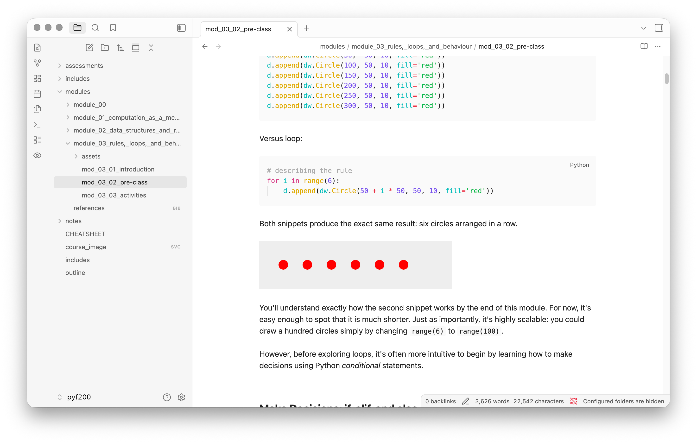
<!--
- recall: edit with any markdown editor you prefer (obsidian in this case) ... [NEXT SLIDE]
- or even ms word (almost vomit)
-->
> obsidian

---

<!--
_backgroundColor: #EEE
_paginate: false
-->
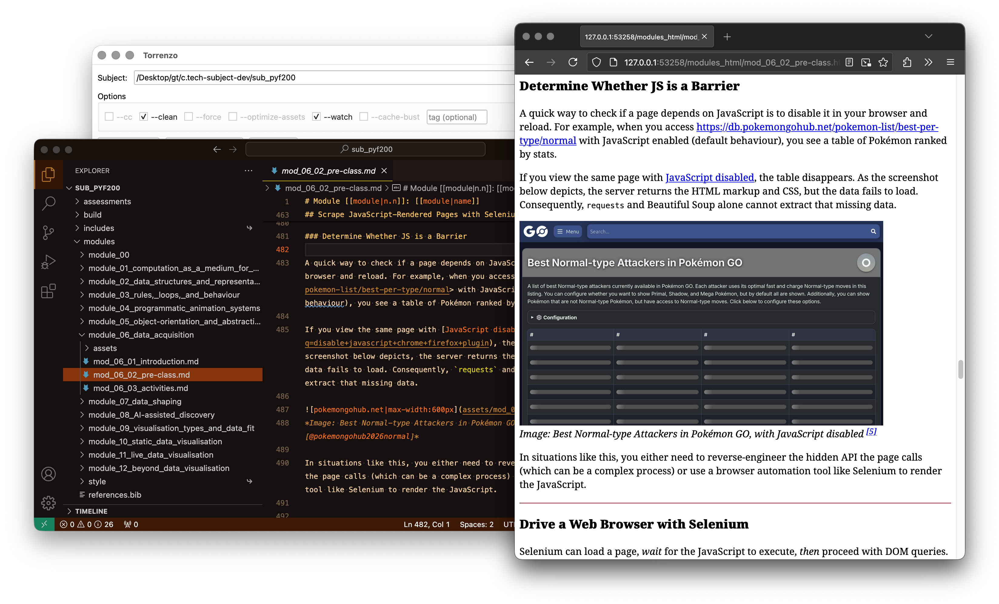
> vs.code
* <svg data-marpit-svg class="absolute">
    <rect x="170" y="85" width="465" height="80" style="fill:none;stroke:lime;stroke-width:5" />
  </svg>
<!--
- using vs.code with [CLICK] torrenzo --watch for hot reload preview in browser
- (this is actually the way i always work)
-->

---

<!--
_backgroundColor: #EEE
_paginate: false
-->


<svg data-marpit-svg class="absolute">
  <defs>
    <linearGradient id="fade-horiz5" x1="0%" y1="0%" x2="100%" y2="0%">
      <stop offset="0%" stop-color="#EEE" stop-opacity="0" />
      <stop offset="40%" stop-color="#EEE" stop-opacity="1" />
    </linearGradient>
  </defs>
  <rect x="840" y="0" width="440" height="720" style="fill:url(#fade-horiz5)" />
  <ellipse cx="1048" cy="365" rx="200" ry="200" stroke-dasharray="3" style="fill:none;stroke:lime;stroke-width:5" />
</svg>

> generated with mermaid
<!--
- ... but there's been this bit of the diagram i've concealed so far ... [NEXT SLIDE]
-->

---

<!--
_backgroundColor: #EEE
_paginate: false
-->

> generated with mermaid
<!--
- ... building and importing into canvas
-->
* <svg data-marpit-svg class="absolute">
    <rect x="855" y="291" width="187" height="75" rx="10" style="fill:none;stroke:red;stroke-width:5" />
  </svg>

---

<!--
_backgroundColor: #EEE
_paginate: false
-->
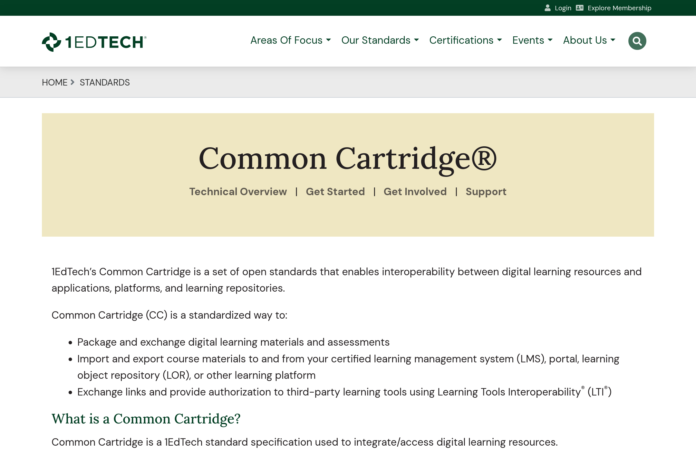
<!--
- offers lms interoperability (standardised format across canvas, moodle, blackboard)
- you can poke about the spec if you wish, but basically --
- zip archive (.imscc extension): to bundle course files and assets into a single portable package
- root manifest xml (imsmanifest.xml): defines file paths, metadata, and course hierarchy
-->
> 1edtech.org

---

<!--
_backgroundColor: #EEE
_paginate: false
-->
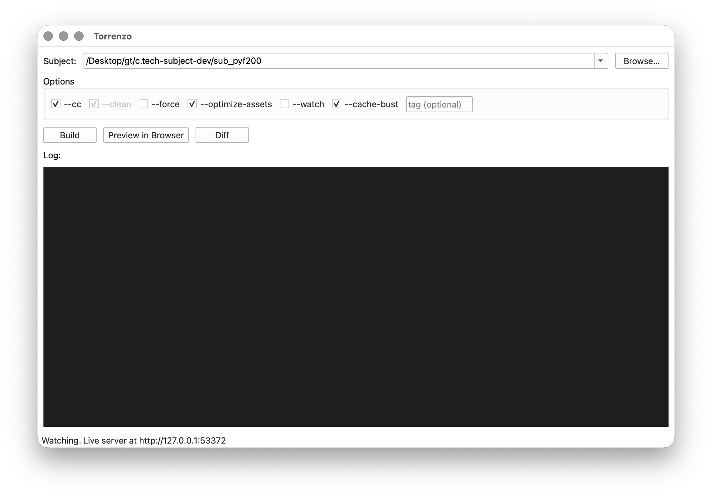
> torrenzo gui

* <svg data-marpit-svg class="absolute">
     <rect x="176" y="120" width="60" height="49" style="fill:none;stroke:lime;stroke-width:5" />
  </svg>
* <svg data-marpit-svg class="absolute">
     <rect x="382" y="120" width="139" height="49" style="fill:none;stroke:lime;stroke-width:5" />
  </svg>
* <svg data-marpit-svg class="absolute">
     <rect x="598" y="120" width="223" height="49" style="fill:none;stroke:lime;stroke-width:5" />
  </svg>

<!--
- typical build settings [CLICK x3 & EXPLAIN]
-->

---

<!--
_backgroundColor: #EEE
_paginate: false
-->
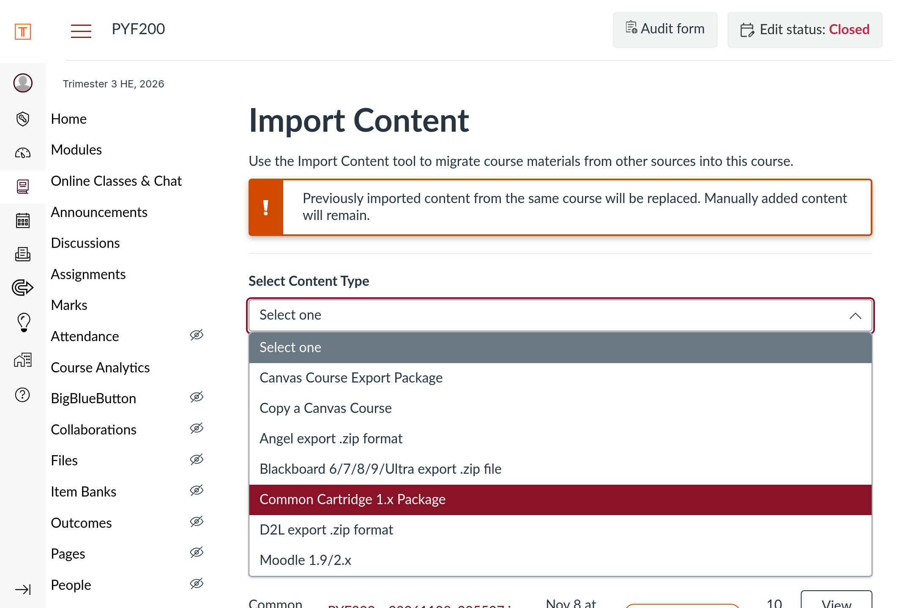
<!--
- importing on canvas side
- it has some sensible rules (only overwrites files not manually edited in canvas)
- (and alerts if/where things that could not overwrite)
-->
> canvas cartridge import

---

# Pipeline Utilities
<!-- 
backgroundColor: steelblue
color: var(--color-background)
-->
<!--
- small utility scripts that automate the fiddly edges
- (not integrated into torrenzo g.u.i ... yet?)
-->

---

## Pipeline Utilities » Utility Scripts

<highlight>`util_generate_procedural_gfx.py`</highlight>  
<smaller>per-module banner SVGs and course images, one palette per subject, seeded randomness</smaller>

<highlight>`util_generate_video_covers.py`</highlight>  
<smaller>a 2-second title slide muxed onto every module video, title derived from the filename</smaller>

<highlight>`util_generate_subtitles.py`</highlight>  
<smaller>draft WebVTT subtitles transcribed by Whisper, never clobbering hand-corrected files</smaller>

<highlight>`util_linter.py`</highlight>  
<smaller>enforces repo conventions: link direction, spelling, rubric weightings, and more</smaller>
<!--
- don't dwell on this slide
-->

---
<!--
_backgroundColor: #EEE
_paginate: false
-->
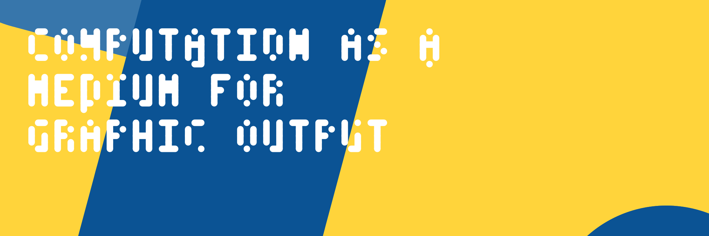


> util_generate_subtitles.py
<!--
- procedurally generated module banners: pixel-raster font, per-subject palette, seeded randomness
- every module page gets a unique banner with zero design time
-->

---
<!--
_backgroundColor: #EEE
_paginate: false
-->
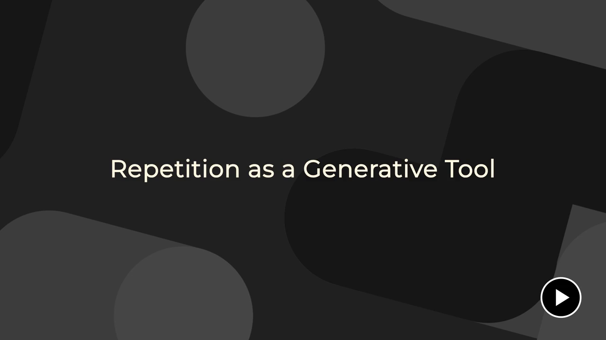
> util_generate_video_covers.py
<!--
- every module video opens with this 2-second cover -- title derived from the filename
- a metadata marker makes re-runs idempotent; rename the file and a fresh cover is muxed in
-->

---
<!--
_backgroundColor: #000
_paginate: false
-->
```
== sub_pyf200 ==
  [error] sub_pyf200/modules/module_02/mod_02_02_pre-class.md:18: reversed link [[Module 3|mod_03_01_introduction]] -- use [[file|Label]] order
  [error] sub_pyf200/modules/module_02/mod_02_02_pre-class.md:42: US spelling: "color"
  [error] sub_pyf200/modules/module_02/mod_02_02_pre-class.md:58: British identifier in code: "bar_colour" -- code naming is always American
  [error] sub_pyf200/modules/module_02/mod_02_02_pre-class.md: bibtex footer comment missing or not verbatim
  [error] sub_pyf200/modules/module_02/mod_02_01_introduction.md:1: introduction H1 must use [[module|sub-name]]
  [error] sub_pyf200/modules/module_03/mod_03_02_pre-class.md:1: pre-class H1 must use [[module|name]]
  [error] sub_pyf200/modules/module_02/mod_02_03_activities.md: missing "## Assessment Progression" section
  [error] sub_pyf200/notes/notes_mod_03.md: activity headings do not mirror student file: ['Loops'] vs ['Loops', 'Patterns']
  [error] sub_pyf200/assessments/assessment_01/ass_01_brief.md:44: rubric header row not in canonical form
  [error] sub_pyf200/assessments/assessment_01/ass_01_brief.md:44: rubric weightings sum to 90%, expected 100%
  [error] sub_pyf200/modules/module_03/assets/old_example.png: asset never referenced in markdown
  [draft] sub_pyf200/modules/module_03/mod_03_01_introduction.md:1: under-construction marker
  [draft] sub_pyf200/modules/module_03/mod_03_02_pre-class.md:12: possible ALL-CAPS TODO line
  [draft] sub_pyf200/modules/module_03/mod_03_03_activities.md:22: placeholder media reference

Exit code: 1 (11 errors and 3 draft warnings).
```
> util_linter.py
<!--
- coverage -- links, spelling, code names, headings, bibtex, activities, notes, rubrics, assets, drafts
- [error] -- convention violation
- [draft] -- unfinished-content warning
-->
---

# The Payoff
<!-- 
backgroundColor: saddlebrown
color: var(--color-background)
-->

---

## The Payoff » What Improved
<p>&nbsp;</p>

### *Speed, Ownership, Maintenance, AI-Assisted Review*
<!--
- the pipeline isn't all-or-nothing: teams dial automation up or down per subject
- and on the last point ... [NEXT SLIDE]
-->

---

## The Payoff » Complete, Local Project

🔎 **Search everything**
<smaller>File manager, editor, or `grep` across all source</smaller><br /><br />

✅ **Automated and batch checks**
<smaller>Broken links, missing citations, orphans (upon build and linter)</smaller><br /><br />

🤖 **AI review**
<smaller>Flag outdated content, references, or material needing clarity</smaller><br /><br />
<!--
- none of this is possible when content lives inside an lms database
-->

---

<!--
_backgroundColor: #EEE
_paginate: false
-->
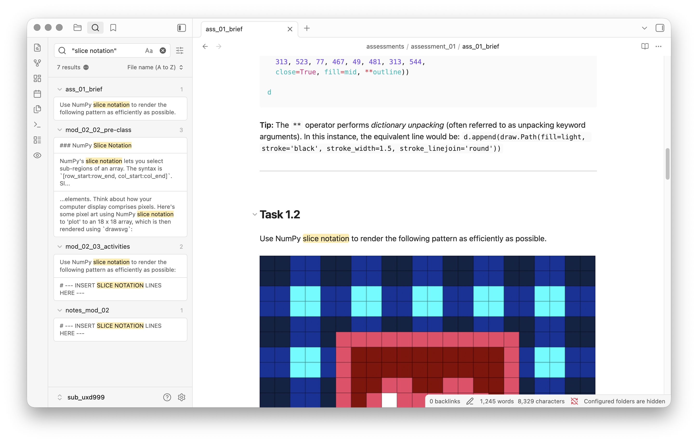
> obsidian find & replace
<!--
- obsidian global search for "slice notation" across the whole subject in milliseconds
- (compare: searching an lms means clicking into every page)
-->

---
<!--
_backgroundColor: #EEE
_paginate: false
-->
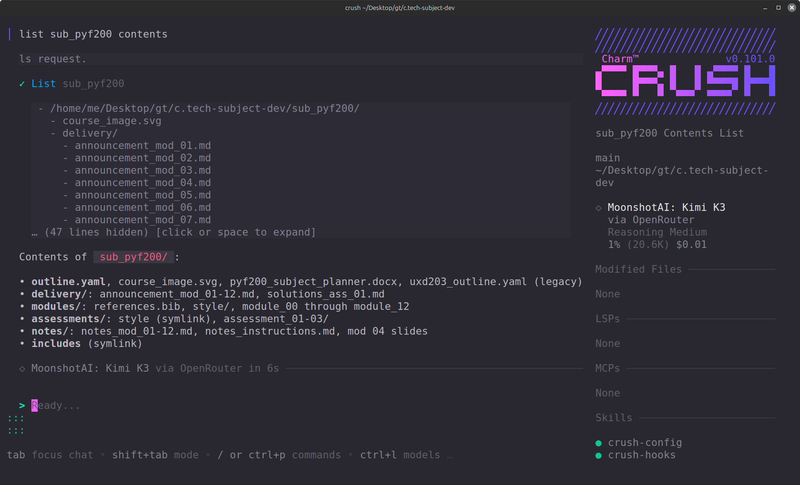
> crush ai agent
<!--
- an ai coding agent working on subject source
- impossible against an lms database; trivial against a folder of markdown
-->

---
<!--
_backgroundColor: #EEE
_paginate: false
-->
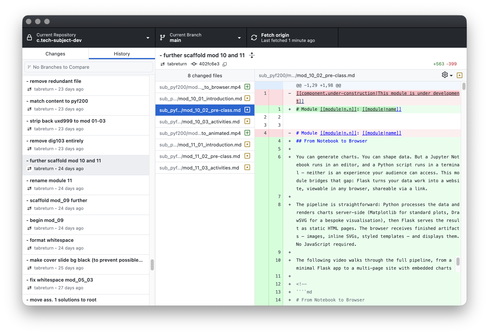
> git history
<!--
- meaningful version history using standard tools, allowing for better collaborative work
- compare with an lms edit log
-->

---

# What Broke
<!-- 
backgroundColor: darkolivegreen
color: var(--color-background)
-->

---

## What Broke » Quirks & Limitations

* <highlight>Canvas import:</highlight> unexpected overwrite behaviour (not additive),  
  duplicated assets after re-import
* <highlight>Image caching:</highlight> images sometimes stop rendering after re-import;  
  worked around with cache-busting asset suffixes
* <highlight>Word support:</highlight> weak on the authoring side
* <highlight>Final 5 percent:</highlight> manual cleanup after each import
* <highlight>Compliance:</highlight> friction accommodating the university process
<!--
- the cartridge import overwriting rather than adding caught us by surprise early on
- the image-caching bug is still unexplained; renaming assets per build sidesteps it
- the last 5% is accepted as the cost of the other 95%
-->

---

# Takeaways
<!-- 
backgroundColor: darkslateblue
color: var(--color-background)
-->

---

## Takeaways

* Treat the LMS as a <highlight>deployment target</highlight>, not an authoring environment
* The <highlight>repository is the source of truth</highlight>; builds are reproducible
* Plain text + a build pipeline returns <highlight>ownership, speed, and reviewability</highlight>
* Expect platform quirks -- budget for a manual final 5 percent
<!--
- the workflow is lightweight by design: yaml, markdown, bibtex, and a build script
- next step for anyone curious: start with one module, not a whole subject
-->

---

## *End*
<!-- 
paginate: false 
backgroundColor: black
color: var(--color-background)
-->

